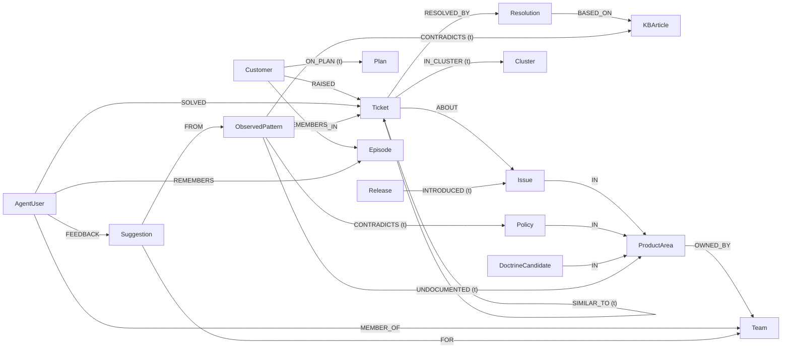

# Mochi Brain

A support desk where no ticket starts from zero.

Mochi Brain keeps one shared company memory in a FalkorDB graph. When an agent opens a ticket, Mochi briefs them: who the customer is, what fixed similar tickets, the likely cause, and who knows the issue. Every answer shows the graph path and the Cypher that produced it. Each night the brain "dreams": it reads the day's tickets, retires facts that stopped being true, finds places where the docs and the real work disagree, and writes a morning report.

All data is synthetic. The broker, **E Corp Securities**, is fictional. No real customer or company data is used anywhere in this repo.

Built for **Graph Hacks: Context for AI Agents** (WeMakeDevs × FalkorDB, Oct 15–18 2026).

## Tracks entered

1. **Agents That Act on Connected Data.** The briefing, likely cause, who-knows and blast-radius tools are multi-hop Cypher queries. Each result carries the path walked and the query text.
2. **Agent Memory and Coordination.** Memory tiers as separate graphs (company, team, user, customer), enforced by database ACL users. The dream consolidates memory with temporal invalidation. Pi Durable checkpoints let a crashed run resume.
3. **Company Brain.** Company knowledge in one graph: who owns which product area, who has solved what, what the docs promise against what tickets show. Mismatches become suggestions with ticket evidence, routed to the owning team.

## Setup from a clean clone

Needs Node 24+ and Docker.

```sh
cp .env.example .env          # set the four passwords and ANTHROPIC_API_KEY
docker compose up -d          # FalkorDB 4.22.1 with the ACL users
npm install
npm run gen                   # seeded synthetic dataset -> data/dataset.json, data/eval.json
npm run load                  # writes the graph as mochi_dream
npm run check                 # typecheck + tests; run after npm run load (company-graph tests skip without it)
npm run dev                   # agent: harness + chat endpoint + story API
```

**Sign-in.** The platform (`/app`) and every `/api` route sit behind a login: user `admin`, password `admin@1234`.
These are **demo credentials**: change them in deploy with `MOCHI_LOGIN_USER` / `MOCHI_LOGIN_PASSWORD`, and set
`MOCHI_SESSION_SECRET`. Open without signing in: the landing page, `/blog`, `POST /api/login`, `GET /api/health`, and
reads of published stories and dashboards (`GET /api/stories/<id>`, its live socket, `/story/<id>`, `/dashboard/<id>`),
so shared links keep working. `agent/auth.test.ts` needs a private FalkorDB on `:6400` and skips without one.

Tests create and drop throwaway graphs. Point them at your own FalkorDB, never a shared one (set `FALKORDB_PORT` in `.env`).

| what | where |
|---|---|
| FalkorDB (Redis protocol) | `localhost:6379` |
| FalkorDB Browser (inspect the graph) | http://localhost:3000 (log in as `default` with `FALKORDB_PASSWORD`) |
| Agent server (`PORT`, default 4000) | http://localhost:4000 |
| CopilotKit / AG-UI chat endpoint | http://localhost:4000/api/copilotkit |
| Story API | `GET http://localhost:4000/api/stories/<id>?asOf=<epoch ms>` |
| Live story updates (WebSocket) | `ws://localhost:4000/api/stories/<id>/live` |
| Run the dream now | `POST http://localhost:4000/api/dream/run[?asOf=<epoch ms>]` (signed in, or `x-mochi-admin: $MOCHI_ADMIN_TOKEN`) |
| Desk UI | `npm run dev -w ui`, then http://localhost:5173/app/ (sign in as above) |
| Landing page | `npm run landing` (Vite picks the next free port if 5173 is taken) |

Other scripts: `npm run dream` (one dream now; stop `npm run dev` first, since one process owns the SQLite), `npm run bench`, `npm run check` (typecheck and tests in every workspace), `npm run crash-demo -w agent`.

## Graph data model

Source of truth: [`contracts/graph.ts`](contracts/graph.ts). The loader, the dream, the agent queries and the bench all import names from it.

### Graphs (memory tiers)

One FalkorDB instance holds several graphs:

| graph | what it holds | who writes |
|---|---|---|
| `mochi_company` | the company brain | only `mochi_dream` (the dream and the loader); append-only, facts retired by `valid_until` |
| `mochi_company_prev` | `GRAPH.COPY` of the brain taken before each dream | `mochi_dream` |
| `algo_scratch` | live-edge projection for graph algorithms (they ignore edge properties) | `mochi_dream` |
| `team_<slug>` | shared memory for one team (teachings, doctrine candidates) | that team's members |
| `user_<id>` | personal memory | that user only |
| `cust_<id>` | per-customer episodic memory | user conversations |

Facts beat preferences: the company graph wins on facts, user graphs win on preferences. Every node carries `source` (`seed`, `dream`, `teach`, `session`) and `created_at`, plus provenance such as `source_ticket` or `source_session`.

### ACL users (enforced by the database)

Defined in `docker-compose.yml`, checked against `contracts/graph.ts` by a test. Grants are per command; `%R~` is never used because it blocks `GRAPH.RO_QUERY`.

| user | can do |
|---|---|
| `mochi_reader` | `GRAPH.RO_QUERY`, `GRAPH.EXPLAIN`, `GRAPH.LIST` on `mochi_company` and `team_*`. Used by user conversations and the MCP server. |
| `mochi_dream` | `GRAPH.QUERY`, `GRAPH.RO_QUERY`, `GRAPH.COPY`, `GRAPH.DELETE`, `GRAPH.CONSTRAINT` on `mochi_company`, `mochi_company_prev`, `algo_scratch`, `team_*`. The only writer of the brain. |
| `user_demo` | read `mochi_company`; read and write `user_demo`, `cust_*`, `team_*`. |

A prompt-injected write from a user conversation fails at FalkorDB with `NOPERM`.

### Labels

`Customer`, `Ticket`, `Issue`, `ProductArea`, `Team`, `AgentUser`, `Resolution`, `KBArticle`, `Release`, `Plan`, `Policy`, `ObservedPattern`, `Suggestion`, `DoctrineCandidate`, `Cluster`, `Episode`.

Doctrine (what the company claims) lives on `KBArticle` and `Policy` (`promised_tat_hours`, `steps`). Practice (what happens) lives on `ObservedPattern` (`measured_tat_hours`, `support_count`, `last_seen`), which the dream distills from tickets.

### Edges

| edge | from | to | temporal |
|---|---|---|---|
| `RAISED` | Customer | Ticket | |
| `ON_PLAN` | Customer | Plan | yes |
| `ABOUT` | Ticket | Issue | |
| `IN` | Issue, DoctrineCandidate, Policy | ProductArea | |
| `OWNED_BY` | ProductArea | Team | |
| `SOLVED` | AgentUser | Ticket | |
| `MEMBER_OF` | AgentUser | Team | |
| `RESOLVED_BY` | Ticket | Resolution | |
| `BASED_ON` | Resolution | KBArticle | |
| `INTRODUCED` | Release | Issue | yes |
| `FOLLOWS` | Ticket | Ticket | |
| `MERGED_INTO` | Ticket | Ticket (primary) | |
| `SIMILAR_TO` | Ticket | Ticket (dream-built kNN over embeddings) | yes |
| `CONTRADICTS` | ObservedPattern | KBArticle, Policy | yes |
| `UNDOCUMENTED` | ObservedPattern | ProductArea | yes |
| `SEEN_IN` | ObservedPattern | Ticket | |
| `FROM` | Suggestion | ObservedPattern | |
| `FOR` | Suggestion | Team | |
| `FEEDBACK` | AgentUser | Suggestion | |
| `IN_CLUSTER` | Ticket | Cluster | yes |
| `REMEMBERS` | Customer, AgentUser | Episode (in `cust_*` / `user_*` graphs) | |

### The temporal rule

Every mutable fact is an edge with `valid_from` and `valid_until` (epoch ms). FalkorDB cannot store null, so a live fact has `valid_until = VALID_FOREVER = 253402300799000` (9999-12-31). A contradiction never edits or deletes: it runs `SET old.valid_until = $as_of` and `CREATE`s a new edge.

One filter serves live and past reads. Live reads pass `$as_of = now`:

```text
EDGE_AS_OF(r) = r.valid_from <= $as_of AND r.valid_until > $as_of
NODE_AS_OF(n) = n.created_at <= $as_of
```

Every temporal edge type has a range index on `valid_until` (`CREATE INDEX FOR ()-[r:<TYPE>]-() ON (r.valid_until)`).

### Diagram



`(t)` marks temporal edges.

## Architecture

```text
 simulated helpdesk (sim/) --webhook--> gen/listen.ts --> mochi_company (pending tickets)
                                                              |
 browser (desk UI, CopilotKit chat) --AG-UI--> agent process  |  FalkorDB
                                              |  Pi Durable harness (SQLite)
                                              |  mochi-graph tools ---- RO_QUERY as mochi_reader
                                              |  dream task ----------- writes as mochi_dream
                                              |  story API + WebSocket
```

- **FalkorDB** holds all memory and context. Hand-written Cypher, no ORM, no Graphiti. Vector search uses FalkorDB's vector index on `Ticket.embedding` (1536-dim OpenAI `text-embedding-3-small`; the local 384-dim MiniLM is used only by tests). Clusters use `algo.labelPropagation`. Remove FalkorDB and nothing works.
- **Pi Durable** (`@earendil-works/pi-durable`) is the agent harness. SQLite holds checkpoints and transcripts only, never memory. The root conversation is the support channel. The `mochi-graph` extension gives read tools (`briefing`, `likely_cause`, `who_knows`, `emerging_clusters`, `blast_radius`, `search_similar`, `customer_profile`, `query_graph`, `graph_algorithm`, `build_story`, `render_html`), all replay-safe, and write tools (`record_resolution`, `teach`, `feedback`) with no replay: after a crash the model is told the call was interrupted, and it is never silently repeated. User conversations do not get `record_resolution`.
- **FalkorDB journal (`MOCHI_STORAGE=falkordb`, default `sqlite`).** `agent/storage/falkordb.ts` implements Pi Durable's `Storage` interface on the `mochi_journal` graph, so FalkorDB becomes the only datastore. Each commit batch is one parameterised write query (`UNWIND` inside `CALL {}` subqueries), atomic in FalkorDB, and the `Journal` counter node issues the commit sequence in that same query. Conversations fork as `(:Conversation)-[:FORKED_FROM {at}]->(:Conversation)`; entry visibility is a path match over that chain. Provenance edges: `Entry-[:IN]->Conversation`, `Entry-[:CALLS]->Task` (the tool call), `Entry-[:BY_TASK]->Task`, `Submission-[:TO]->Conversation`, and `Entry-[:WROTE]->Revision-[:OF]->Document` (the tool result that wrote a story). The `trace_story` read tool walks those edges as `mochi_reader`, which may read `~mochi_journal` and never write it. The journal connects as `mochi_journal`, which can write only `~mochi_journal`. Production must run `--appendfsync always`, because crash-resume must not lose a batch the harness already counts as committed. The upstream storage conformance suite passes against it (`agent/storage/falkordb.test.ts`, on a private container at `JOURNAL_TEST_PORT`, default 6392).
- **`query_graph` and `graph_algorithm`.** For questions no fixed tool covers, the model writes its own Cypher against a schema section generated from `contracts/graph.ts`. Its Cypher is model-written, so it is not in the list below; each run is stored as a `q_<n>` receipt with its exact text. It is read-only because the database enforces it (`GRAPH.RO_QUERY` as `mochi_reader`); code adds a write precheck, contract-name check, mandatory `$as_of`, a 5 s timeout and a 200-row cap. `graph_algorithm` runs whitelisted FalkorDB algorithms. Edge sets with no temporal edge run on `mochi_company` through `GRAPH.RO_QUERY`. Any temporal edge means a live-edge projection (`EDGE_AS_OF`) into `algo_scratch`, and that projection is part of the receipt. What each one runs on:
  - `shortest_path`: `algo.SPpaths` over the contract edges, ≤ 4 hops, both directions, returned as a path receipt.
  - `pagerank`: `SIMILAR_TO` plus `SOLVED` projected reversed (Ticket→AgentUser), so rank lands on whoever solved tickets that sit at the centre of the similarity graph. Spearman against solved-count degree: 0.923 on the seeded data (OpenAI embeddings).
  - `communities`: label propagation over live `Ticket·SIMILAR_TO`. Adjusted Rand index against the issue labels: 0.309, so it does not just return the issue labels.
  - `components`: WCC over `Customer/Ticket` via `RAISED`, `FOLLOWS`, `MERGED_INTO` (repeat-contact loops).
  - `betweenness`: Ticket/Issue/ProductArea via `ABOUT`, `SIMILAR_TO`, `IN`, sampled with seed 42. It ranks issues and areas that bridge similar tickets across issues.
  - `neighbourhood`: `algo.bfs` over one edge type, depth ≤ 2.
- **CopilotKit chat.** The web chat uses CopilotKit's headless React packages and speaks AG-UI to our endpoint, hosted inside the agent process next to the harness. Answers render as tool cards built by our code (numbers come from query rows, never from model tokens), then story tags, then sandboxed HTML as a last resort. The sandbox allows only `mochi.css` tokens, no network, and no literal digits: every figure is a placeholder filled from a stored query.
- **`/story` and `/dashboard`.** Start a chat message with `/story` or `/dashboard` and the model gathers the data (fixed tools, or its own Cypher through `query_graph` and `graph_algorithm`), then calls `build_story` with that kind. The result is a draft only you see until you press Publish; a dashboard is a `<grid>` of live tiles. Both are markdown plus `query_id` tags, so every number in them is a stored query.
- **The dream** is a Pi Durable background task on a timer (`MOCHI_DREAM_EVERY_MS`, default 24 h), or `npm run dream`, or `POST /api/dream/run`. Steps: snapshot (`GRAPH.COPY` to `mochi_company_prev`) → ingest (LLM extraction into `MERGE` Cypher, marked by `ingested_at`; a second issue in the same email adds a second `ABOUT`) → similarity (each ticket's 6 nearest neighbours by vector index, kept when the distance is within the night's median, become temporal `SIMILAR_TO` edges) → invalidate (contradiction events retire old edges) → clusters → practice (ObservedPatterns) → mismatch rules → suggestions → doctrine review → morning report. The mismatch rules are plain arithmetic and Cypher, no LLM: a pattern whose measured time exceeds a promise by more than 25% with at least 5 supporting tickets becomes `CONTRADICTS`; a workaround used often but in no KB becomes `UNDOCUMENTED`. The LLM writes only the suggestion prose. Teachings from chat land as `DoctrineCandidate` nodes; the dream reviews and commits them as `Policy` with `taught_by` and `source_session`.
- **The simulated helpdesk** (`sim/`, `npm run sim`). A fictional, Freshdesk-shaped ticketing system with about 3,000 E Corp Securities tickets and their mail threads: follow-ups, duplicates, merges, CC'd parties, auto-replies, bounces, spam, forwards, Hinglish. It serves a `/api/v2/` REST API with Basic auth and pagination, POSTs webhooks on a replay clock (`/sim/clock`), and keeps its ground truth in a file it never serves. `gen/listen.ts` takes each webhook, fetches the ticket and writes it to the graph as pending; the dream does the extraction. The graph, the eval and the benchmark all come from that one source. Facts never pass through the LLM: Haiku only rewords tone, and the paraphrase cache is committed so reruns cost nothing.

## Receipts and `?asOf=`

Every number in a card, story or report carries its stored query: Cypher text, graph, params, columns and rows. Click a number to see the Cypher. Every story has a link `/r/<storyId>` (versions `/r/<storyId>@<n>`); refresh re-runs the stored queries read-only, and open tabs update over WebSocket.

`?asOf=<epoch ms>` re-runs the same stored queries with that time as `$as_of`. You see what the brain believed then. Compare a report before and after a dream to watch facts retire.

## Ask the graph yourself (MCP server for judges)

`.mcp.json` registers the official FalkorDB MCP server (`@falkordb/mcpserver@1.3.0`), read-only, connected as `mochi_reader`. Open the repo in Claude Code (or any MCP client) with your `.env` loaded and ask questions about `mochi_company` directly. Writes are refused twice: by the server's strict read-only mode and by the ACL user.

## Crash demo

```sh
npm run crash-demo -w agent
```

It submits a ticket with a fixed `requestId`, sends `kill -9` while the first tool call is running, reopens the same SQLite, calls `harness.resume()` and resubmits the same `requestId`. The original submission comes back and finishes with one answer. This is demonstrated, not benchmarked.

## Benchmark

```sh
npm run bench                               # everything, from the seed
npm run bench -- --only main                # one section: main, staleness, ablation, clusters, concurrency, isolation, server
npm run bench -- --dry                      # no API spend; writes artifacts/results.dry.json
npm run bench -- --max-usd 25               # stop at a spend cap
```

Arms: A stuff-everything, B vector top-k (FalkorDB vector index, edges ignored), C file memory (the open Agent Memory Repo spec, not Devin the product), D graph (the queries below), E SQLite relational, F TencentDB Agent Memory (time-boxed). Tokens come from the provider's usage field. Single-fact answers are scored by exact match; multi-hop and structural by an LLM judge (prompt in `bench/judge.md`). Output: `bench/results.json`, the only source of published figures. We report the buckets where other arms win.

Arm F is not measured. TencentDB Agent Memory runs its extraction LLM calls in a separate HTTP gateway that bypasses our cost meter and spend cap, so its tokens could not be counted honestly. `bench/artifacts/arm-f.md` records what we checked and which step failed.

### Feature Ledger

Every graph feature has a row, good or bad. A row that says "not measured" says so in public.

<!-- ledger:start (generated by scripts/readme-cypher.ts, do not edit) -->
Source: `bench/results.json`, run at 2026-10-18T10:25:59.413Z, seed 42.

| feature | graph mechanism | measured against | result | status |
|---|---|---|---|---|
| briefing retrieval | multi-hop Cypher | arms A/B/C/E (main benchmark; E = the same tools as SQLite SQL plus query_sql; E has no algorithm tools: SQLite has no PageRank/CDLP; paths only via recursive CTE through query_sql) | D 47/50 vs E 36/50 vs C 19/50 vs B 14/50 vs A 27/50 | measured |
| TencentDB Agent Memory comparison (arm F) | multi-hop Cypher | TencentDB Agent Memory, not integrated: its extraction runs in a separate HTTP gateway whose LLM calls bypass the bench meter and cost cap (bench/artifacts/arm-f.md) | not measured | not measured |
| mismatch detection | deterministic CONTRADICTS/UNDOCUMENTED rules | LLM given all docs+tickets as text; 5 planted mismatches | graph found 5/5, 0 hallucinated, 2862 tokens vs LLM found 5/5, 16 hallucinated, 207399 tokens | measured |
| emerging clusters | community detection (CDLP) over the dream's SIMILAR_TO kNN edges (no seeded issue links read; dream tokens counted, embedding tokens not) | LLM clustering of the same week's raw ticket text vs planted bad-release spikes | graph 5/7 spikes, 0 spurious, 2854 tokens vs LLM 5/7 spikes, 9 spurious, 25219 tokens | measured |
| crash resume | Pi Durable checkpoints | demonstrated, not benchmarked | demonstrated by agent/scripts/crash-demo.ts, not benchmarked | demonstrated |
| tier isolation | Redis ACL users per tier | refusal cases as mochi_reader | 4/4 refused as mochi_reader | measured |
| multi-agent concurrency | N parallel briefings while the dream writes; multigraph isolation | latency p50/p95 vs N, torn-read assertion, one graph vs per-user graphs | N=25: p50 7.8ms, p95 10.24ms, 2028.74/s; torn reads 0 across N=1/5/10/25; readers p95 one graph 9.15ms vs per-user 6.82ms (single container, admin user on a scratch copy) | measured |
| decision traces | mochi_traces Trace/Step/Query graph, Trace.embedding vector index, SIMILAR_TO-first ticket lookup, receipts re-checked at as_of | learning-from-past-tickets approaches on the same 40 later tickets, lessons from the same 40 earlier resolved tickets (bench/arms/lessons.ts); staleness after 10 retirements | D 40/40, $0.000926/task, 8835/85 tok, 2 LLM calls, p50 1971ms, fresh 10/10; graph traces (warm replay) 39/40, $0.000482/task, 4738/16 tok, 1 LLM calls, p50 1323ms, fresh 9/10; file memory C 40/40, $0.000767/task + $0.159 dream once, 7547/26 tok, 2 LLM calls, p50 1818ms; C + LESSONS.md 40/40, $0.001113/task, 10972/31 tok, 2 LLM calls, p50 1829ms, fresh 0/10 (stale resurfaced 10); Devin-style Knowledge (modelled on Devin's documented Knowledge feature, not Devin itself) 30/40, $0.000233/task, 1965/73 tok, 2 LLM calls, p50 1842ms, fresh 0/10 (stale resurfaced 8); vector lessons top-3 29/40, $0.000059/task, 530/11 tok, 2 LLM calls, p50 1332ms, fresh 0/10 (stale resurfaced 10); SQL lessons 28/40, $0.000366/task, 2644/202 tok, 2 LLM calls, p50 2266ms, fresh 0/10 (stale resurfaced 8) | measured |
<!-- ledger:end -->

## The Cypher the product depends on

Generated from the code by `scripts/readme-cypher.ts`. `node scripts/readme-cypher.ts --check` fails if this section drifts from the code. `${EDGE_AS_OF}` and `${NODE_AS_OF}` are already expanded below.

<!-- cypher:start (generated by scripts/readme-cypher.ts, do not edit) -->
### Agent queries (the five load-bearing queries + similarity)

Source: `agent/queries/index.ts`.

#### `briefing.profile`

```cypher
/* mochi:briefing.profile@v1 */
MATCH (c:Customer)-[:RAISED]->(t:Ticket {id: $ticketId})
WHERE c.created_at <= $as_of AND t.created_at <= $as_of
OPTIONAL MATCH (c)-[op:ON_PLAN]->(p:Plan) WHERE op.valid_from <= $as_of AND op.valid_until > $as_of
OPTIONAL MATCH (t)-[:ABOUT]->(i:Issue) WHERE i.created_at <= $as_of
RETURN c.id AS customer_id, c.name AS name, c.segment AS segment, c.city AS city, p.name AS plan,
       t.subject AS ticket_subject, i.id AS issue_id
```

#### `briefing.recent`

```cypher
/* mochi:briefing.recent@v1 */
MATCH (c:Customer)-[:RAISED]->(:Ticket {id: $ticketId}), (c)-[r:RAISED]->(t:Ticket)
WHERE t.id <> $ticketId AND t.created_at <= $as_of
RETURN t.id AS ticket, t.subject AS subject, t.status AS status, t.created_at AS created_at
ORDER BY t.created_at DESC, t.id LIMIT 3
```

#### `briefing.similar`

```cypher
/* mochi:briefing.similar@v1 path: graph */
MATCH (t:Ticket {id: $ticketId})-[:ABOUT]->(i:Issue)<-[:ABOUT]-(s:Ticket)-[:RESOLVED_BY]->(r:Resolution)
WHERE s.id <> t.id AND t.created_at <= $as_of AND i.created_at <= $as_of AND s.created_at <= $as_of AND r.created_at <= $as_of AND s.resolved_at <= $as_of
OPTIONAL MATCH (r)-[:BASED_ON]->(k:KBArticle) WHERE k.created_at <= $as_of
RETURN s.id AS ticket, s.subject AS subject, i.id AS issue_id, i.name AS issue,
       r.id AS resolution_id, r.summary AS resolution, k.id AS kb_id, k.title AS kb
ORDER BY s.resolved_at DESC, s.id LIMIT 5
```

#### `briefing.similarVector`

```cypher
/* mochi:briefing.similar@v1 path: vector→graph */
MATCH (t:Ticket {id: $ticketId})
CALL db.idx.vector.queryNodes('Ticket', 'embedding', $k, t.embedding) YIELD node, score
WITH t, node AS s, score
WHERE s.id <> t.id AND s.created_at <= $as_of AND s.resolved_at <= $as_of
MATCH (s)-[:RESOLVED_BY]->(r:Resolution) WHERE r.created_at <= $as_of
OPTIONAL MATCH (s)-[:ABOUT]->(i:Issue)
OPTIONAL MATCH (r)-[:BASED_ON]->(k:KBArticle) WHERE k.created_at <= $as_of
RETURN s.id AS ticket, s.subject AS subject, i.id AS issue_id, i.name AS issue,
       r.id AS resolution_id, r.summary AS resolution, k.id AS kb_id, k.title AS kb, score
ORDER BY score, s.id LIMIT 5
```

#### `briefing.suggestions`

```cypher
/* mochi:briefing.suggestions@v1 */
MATCH (t:Ticket {id: $ticketId})-[:ABOUT]->(i:Issue)-[:IN]->(a:ProductArea)-[:OWNED_BY]->(tm:Team)<-[:FOR]-(s:Suggestion)-[:FROM]->(p:ObservedPattern)-[e:CONTRADICTS|UNDOCUMENTED]->(d)
WHERE s.area = a.name AND s.status = 'open' AND s.expires_at > $as_of AND t.created_at <= $as_of AND s.created_at <= $as_of AND e.valid_from <= $as_of AND e.valid_until > $as_of
RETURN DISTINCT s.id AS suggestion_id, type(e) AS edge, coalesce(d.id, d.name) AS target, a.name AS area, tm.name AS team,
       s.text AS text, s.support_count AS support, p.measured_tat_hours AS measured, e.promised AS promised, s.confidence AS confidence
ORDER BY confidence DESC, suggestion_id LIMIT 2
```

#### `likelyCause`

```cypher
/* mochi:likely_cause@v1 */
MATCH (t:Ticket {id: $ticketId})-[:ABOUT]->(i:Issue)<-[x:INTRODUCED]-(r:Release)
WHERE x.valid_from <= $as_of AND x.valid_until > $as_of AND t.created_at <= $as_of AND i.created_at <= $as_of AND r.created_at <= $as_of
RETURN t.id AS ticket, t.subject AS subject, i.id AS issue_id, i.name AS issue,
       r.version AS release, r.shipped_at AS shipped_at, x.valid_from AS introduced_at
ORDER BY r.shipped_at DESC, r.version LIMIT 3
```

#### `whoKnows`

```cypher
/* mochi:who_knows@v1 */
MATCH (i:Issue) WHERE (i.id = $issueId OR toLower(i.name) = toLower($issueId)) AND i.created_at <= $as_of
MATCH (a:AgentUser)-[s:SOLVED]->(t:Ticket)-[:ABOUT]->(i)
WHERE a.created_at <= $as_of AND t.created_at <= $as_of
WITH a, i, count(s) AS solved, min(t.id) AS example_ticket
OPTIONAL MATCH (a)-[:MEMBER_OF]->(tm:Team)
RETURN a.id AS agent_id, a.name AS agent, tm.name AS team, solved, example_ticket, i.name AS issue
ORDER BY solved DESC, agent_id LIMIT 5
```

#### `whoKnowsIssues`

```cypher
/* mochi:who_knows.issues@v1 */
MATCH (i:Issue) WHERE i.created_at <= $as_of
RETURN i.id AS issue_id, i.name AS issue
ORDER BY issue_id
```

#### `emergingClusters`

```cypher
/* mochi:emerging_clusters@v1 */
MATCH (t:Ticket)-[m:IN_CLUSTER]->(c:Cluster)
WHERE m.valid_from <= $as_of AND m.valid_until > $as_of AND c.created_at <= $as_of AND t.created_at <= $as_of
WITH c, count(m) AS tickets, sum(CASE WHEN t.created_at > $as_of - $window_ms THEN 1 ELSE 0 END) AS growth
RETURN c.id AS cluster, tickets, growth
ORDER BY growth DESC, tickets DESC, cluster LIMIT 10
```

#### `blastRadius.segments`

```cypher
/* mochi:blast_radius.segments@v1 */
MATCH (r:Release {version: $version})-[x:INTRODUCED]->(i:Issue)<-[a:ABOUT]-(t:Ticket)<-[rz:RAISED]-(c:Customer)
WHERE x.valid_from <= $as_of AND x.valid_until > $as_of AND r.created_at <= $as_of AND i.created_at <= $as_of AND t.created_at <= $as_of AND c.created_at <= $as_of
RETURN c.segment AS segment, count(DISTINCT c) AS customers, count(DISTINCT t) AS tickets
ORDER BY customers DESC, segment
```

#### `blastRadius.totals`

```cypher
/* mochi:blast_radius.totals@v1 */
MATCH (r:Release {version: $version})-[x:INTRODUCED]->(i:Issue)<-[a:ABOUT]-(t:Ticket)<-[rz:RAISED]-(c:Customer)
WHERE x.valid_from <= $as_of AND x.valid_until > $as_of AND r.created_at <= $as_of AND i.created_at <= $as_of AND t.created_at <= $as_of AND c.created_at <= $as_of
RETURN count(DISTINCT c) AS customers, count(DISTINCT t) AS tickets,
       count(DISTINCT CASE WHEN t.resolved_at IS NULL OR t.resolved_at > $as_of THEN t END) AS open_tickets
```

#### `blastRadius.affected`

```cypher
/* mochi:blast_radius.affected@v1 */
MATCH (r:Release {version: $version})-[x:INTRODUCED]->(i:Issue)<-[a:ABOUT]-(t:Ticket)<-[rz:RAISED]-(c:Customer)
WHERE x.valid_from <= $as_of AND x.valid_until > $as_of AND r.created_at <= $as_of AND i.created_at <= $as_of AND t.created_at <= $as_of AND c.created_at <= $as_of
RETURN c.id AS customer_id, c.name AS customer, c.segment AS segment, t.id AS ticket, t.subject AS subject,
       i.id AS issue_id, i.name AS issue,
       CASE WHEN t.resolved_at IS NULL OR t.resolved_at > $as_of THEN 'open' ELSE 'resolved' END AS state
ORDER BY t.created_at DESC, t.id LIMIT 10
```

#### `blastRadius.owner`

```cypher
/* mochi:blast_radius.owner@v1 */
MATCH (r:Release {version: $version})-[x:INTRODUCED]->(i:Issue)-[:IN]->(a:ProductArea)-[:OWNED_BY]->(tm:Team)
WHERE x.valid_from <= $as_of AND x.valid_until > $as_of AND r.created_at <= $as_of AND i.created_at <= $as_of
RETURN tm.name AS team, a.name AS area, collect(DISTINCT i.name) AS issues
ORDER BY team, area LIMIT 3
```

#### `searchSimilar`

```cypher
/* mochi:search_similar@v1 */
CALL db.idx.vector.queryNodes('Ticket', 'embedding', $fetch, vecf32($vector)) YIELD node, score
WITH node AS t, score WHERE t.created_at <= $as_of
OPTIONAL MATCH (t)-[:ABOUT]->(i:Issue)
RETURN t.id AS ticket, t.subject AS subject, t.status AS status, i.name AS issue, score
ORDER BY score, ticket LIMIT $k
```

#### `customerProfile.profile`

```cypher
/* mochi:customer_profile.profile@v1 */
MATCH (c:Customer {id: $customerId}) WHERE c.created_at <= $as_of
OPTIONAL MATCH (c)-[op:ON_PLAN]->(p:Plan) WHERE op.valid_from <= $as_of AND op.valid_until > $as_of
RETURN c.id AS customer_id, c.name AS name, c.segment AS segment, p.name AS plan, c.city AS city
```

#### `customerProfile.history`

```cypher
/* mochi:customer_profile.history@v1 */
MATCH (c:Customer {id: $customerId})-[:RAISED]->(t:Ticket)
WHERE t.created_at <= $as_of AND t.status IN ['resolved', 'closed'] AND NOT (t)-[:MERGED_INTO]->(:Ticket)
OPTIONAL MATCH (t)-[:RESOLVED_BY]->(r:Resolution) WHERE r.created_at <= $as_of
RETURN t.id AS ticket, t.subject AS subject, t.created_at AS created_at, t.status AS status,
       r.kind AS resolution_kind, coalesce(r.summary, 'Closed with no recorded fix') AS ended
ORDER BY t.created_at DESC, t.id LIMIT 10
```

#### `customerProfile.open`

```cypher
/* mochi:customer_profile.open@v1 */
MATCH (c:Customer {id: $customerId})-[:RAISED]->(t:Ticket)
WHERE t.created_at <= $as_of AND NOT t.status IN ['resolved', 'closed']
RETURN t.id AS ticket, t.subject AS subject, t.created_at AS created_at, t.status AS status
ORDER BY t.created_at DESC, t.id LIMIT 10
```

#### `customerProfile.merged`

```cypher
/* mochi:customer_profile.merged@v1 */
MATCH (c:Customer {id: $customerId})-[:RAISED]->(d:Ticket)-[:MERGED_INTO]->(p:Ticket)
WHERE d.created_at <= $as_of AND p.created_at <= $as_of
RETURN d.id AS ticket, d.subject AS subject, p.id AS merged_into
ORDER BY d.created_at DESC, d.id LIMIT 10
```

#### `entity.customerActivity`

```cypher
/* mochi:entity.customer_activity@v1 */
MATCH (c:Customer {id: $customerId})-[:RAISED]->(t:Ticket) WHERE t.created_at <= $as_of
WITH t ORDER BY t.created_at DESC, t.id
RETURN sum(CASE WHEN t.status IN ['resolved', 'closed'] THEN 0 ELSE 1 END) AS open_tickets,
       max(t.created_at) AS last_contact, head(collect(t.id)) AS latest_ticket
```

#### `entity.ticket`

```cypher
/* mochi:entity.ticket@v1 */
MATCH (c:Customer)-[:RAISED]->(t:Ticket {id: $ticketId}) WHERE t.created_at <= $as_of
OPTIONAL MATCH (t)-[:RESOLVED_BY]->(r:Resolution) WHERE r.created_at <= $as_of
RETURN t.id AS ticket, t.subject AS subject, t.status AS status, t.created_at AS created_at,
       r.summary AS resolution, c.id AS customer_id, c.name AS customer
```

#### `entity.kb`

```cypher
/* mochi:entity.kb@v1 */
MATCH (k:KBArticle {id: $kbId}) WHERE k.created_at <= $as_of
OPTIONAL MATCH (a:ProductArea {name: k.area})-[:OWNED_BY]->(tm:Team)
RETURN k.id AS kb_id, k.title AS title, k.area AS area, tm.name AS team, k.promised_tat_hours AS promised_tat_hours
```

#### `entity.search`

```cypher
/* mochi:entity.search@v1 */
MATCH (t:Ticket) WHERE t.created_at <= $as_of AND toLower(t.id) CONTAINS $q
RETURN 'ticket' AS kind, t.id AS id, t.subject AS name ORDER BY t.created_at DESC, t.id LIMIT 8
UNION ALL
MATCH (c:Customer) WHERE c.created_at <= $as_of AND (toLower(c.id) CONTAINS $q OR toLower(c.name) CONTAINS $q)
RETURN 'customer' AS kind, c.id AS id, c.name AS name ORDER BY c.id LIMIT 8
UNION ALL
MATCH (i:Issue) WHERE i.created_at <= $as_of AND toLower(i.name) CONTAINS $q
RETURN 'issue' AS kind, i.id AS id, i.name AS name ORDER BY i.name, i.id LIMIT 8
```

#### `deskGuess`

```cypher
/* mochi:desk.guess@v1 */
UNWIND $ids AS tid
MATCH (t:Ticket {id: tid}) WHERE t.created_at <= $as_of
OPTIONAL MATCH (t)-[:ABOUT]->(i:Issue) WHERE i.created_at <= $as_of
OPTIONAL MATCH (i)<-[:ABOUT]-(s:Ticket)-[:RESOLVED_BY]->(r:Resolution)
WHERE s.id <> t.id AND s.created_at <= $as_of AND r.created_at <= $as_of AND s.resolved_at <= $as_of
WITH t, i, r, count(s) AS support
ORDER BY support DESC, r.id
WITH t, i, collect(CASE WHEN r IS NULL THEN null ELSE [r.id, r.summary, support] END) AS fixes, sum(support) AS resolved
RETURN t.id AS ticket, t.ingested_at IS NOT NULL AS ingested, i.id AS issue_id, i.name AS issue,
       fixes[0][0] AS resolution_id, fixes[0][1] AS resolution, coalesce(fixes[0][2], 0) AS support_count, resolved,
       CASE WHEN resolved > 0 THEN toFloat(fixes[0][2]) / resolved ELSE null END AS confidence
ORDER BY ticket, issue_id
```

#### `deskCounts`

```cypher
/* mochi:desk.counts@v1 */
OPTIONAL MATCH (t:Ticket) WHERE t.ingested_at > $as_of - $window_ms AND t.ingested_at <= $as_of
WITH count(t) AS ingested
OPTIONAL MATCH (p:Ticket) WHERE p.created_at <= $as_of AND p.ingested_at IS NULL
WITH ingested, count(p) AS pending
OPTIONAL MATCH (:Ticket)-[m:IN_CLUSTER]->(c:Cluster) WHERE m.valid_from <= $as_of AND m.valid_until > $as_of
WITH ingested, pending, count(DISTINCT c) AS clustered
OPTIONAL MATCH ()-[x]->() WHERE x.valid_until > $as_of - $window_ms AND x.valid_until <= $as_of
WITH ingested, pending, clustered, count(x) AS retired
OPTIONAL MATCH (:ObservedPattern)-[y:CONTRADICTS|UNDOCUMENTED]->() WHERE y.valid_from <= $as_of AND y.valid_until > $as_of
RETURN ingested, pending, clustered, retired, count(y) AS mismatches
```

### Dream queries (the only writer of mochi_company)

Source: `agent/dream/cypher.ts`.

#### `pendingTickets`

```cypher
MATCH (t:Ticket) WHERE t.ingested_at IS NULL AND t.created_at <= $as_of
OPTIONAL MATCH (t)-[:ABOUT]->(i:Issue)
OPTIONAL MATCH (t)-[:RESOLVED_BY]->(res:Resolution)
RETURN t.id AS id, t.subject AS subject, t.body AS body, t.status AS status, i.id AS issue_id, res.id AS res_id
ORDER BY t.id
```

#### `areas`

```cypher
MATCH (a:ProductArea) RETURN a.name AS name
```

#### `issues`

```cypher
MATCH (i:Issue)-[:IN]->(a:ProductArea) RETURN i.id AS id, i.name AS name, a.name AS area, i.created_at AS created_at ORDER BY i.created_at DESC, i.id
```

#### `ingestBatch`

```cypher
UNWIND $rows AS r
MATCH (t:Ticket {id: r.ticket_id}) WHERE t.ingested_at IS NULL
MATCH (a:ProductArea {name: r.area})
MERGE (i:Issue {id: r.issue_id})
ON CREATE SET i.name = r.issue_name, i.first_seen = t.created_at, i.created_at = $as_of, i.source = 'dream', i.source_ticket = r.ticket_id
MERGE (i)-[:IN]->(a)
MERGE (t)-[:ABOUT]->(i)
SET t.ingested_at = $as_of, t.batch_id = $batch_id, t.batch_size = $batch_size
WITH t, r
FOREACH (_ IN CASE WHEN r.res_kind <> '' THEN [1] ELSE [] END |
  MERGE (res:Resolution {id: r.res_id})
  ON CREATE SET res.kind = r.res_kind, res.summary = r.res_summary, res.created_at = $as_of, res.source = 'dream', res.source_ticket = r.ticket_id
  MERGE (t)-[:RESOLVED_BY]->(res))
WITH t, r
FOREACH (_ IN CASE WHEN r.issue2_id <> '' THEN [1] ELSE [] END |
  MERGE (a2:ProductArea {name: r.area2})
  MERGE (i2:Issue {id: r.issue2_id})
  ON CREATE SET i2.name = r.issue2_name, i2.first_seen = t.created_at, i2.created_at = $as_of, i2.source = 'dream', i2.source_ticket = r.ticket_id
  MERGE (i2)-[:IN]->(a2)
  MERGE (t)-[x:ABOUT]->(i2)
  ON CREATE SET x.source = 'dream', x.created_at = $as_of, x.batch_id = $batch_id, x.second_issue = true)
RETURN count(t) AS written
```

#### `knn`

```cypher
UNWIND $ids AS id
MATCH (t:Ticket {id: id}) WHERE t.embedding IS NOT NULL AND t.created_at <= $as_of
CALL db.idx.vector.queryNodes('Ticket', 'embedding', 7, t.embedding) YIELD node, score
WITH t, node, score WHERE node <> t AND node.created_at <= $as_of
RETURN t.id AS a, node.id AS b, score ORDER BY a, score, b
```

#### `ticketIds`

```cypher
MATCH (t:Ticket) WHERE t.created_at <= $as_of RETURN t.id AS id ORDER BY id
```

#### `liveSimilar`

```cypher
MATCH (a:Ticket)-[s:SIMILAR_TO]->(b:Ticket) WHERE s.valid_from <= $as_of AND s.valid_until > $as_of RETURN a.id AS a, b.id AS b
```

#### `retireSimilar`

```cypher
UNWIND $rows AS r
MATCH (:Ticket {id: r.a})-[s:SIMILAR_TO]->(:Ticket {id: r.b}) WHERE s.valid_from <= $as_of AND s.valid_until > $as_of
SET s.valid_until = $as_of
RETURN count(s) AS retired
```

#### `createSimilar`

```cypher
UNWIND $rows AS r
MATCH (a:Ticket {id: r.a}), (b:Ticket {id: r.b})
CREATE (a)-[s:SIMILAR_TO {score: r.score, valid_from: $as_of, valid_until: 253402300799000, source: 'dream', created_at: $as_of}]->(b)
RETURN count(s) AS created
```

#### `windowPairs`

```cypher
MATCH (t:Ticket)-[:ABOUT]->(i:Issue)
WHERE t.created_at > $as_of - 604800000 AND t.created_at <= $as_of AND i.created_at <= $as_of
RETURN t.id AS t, i.id AS i, i.name AS name ORDER BY t.id, i.id
```

#### `projectPairs`

```cypher
UNWIND $rows AS r MERGE (t:Ticket {id: r.t}) MERGE (i:Issue {id: r.i}) MERGE (t)-[:ABOUT]->(i)
```

#### `labelPropagation`

```cypher
CALL algo.labelPropagation({nodeLabels: ['Ticket', 'Issue'], relationshipTypes: ['ABOUT'], maxIterations: 10}) YIELD node, communityId
WITH node, communityId WHERE node:Ticket
RETURN communityId, node.id AS id ORDER BY id
```

#### `retireClusterEdges`

```cypher
UNWIND $rows AS r
MATCH (t:Ticket {id: r.t})-[old:IN_CLUSTER]->(oc:Cluster)
WHERE old.valid_from <= $as_of AND old.valid_until > $as_of AND oc.id <> r.c
SET old.valid_until = $as_of
RETURN count(old) AS retired
```

#### `createClusterEdges`

```cypher
UNWIND $rows AS r
MATCH (t:Ticket {id: r.t})
MERGE (c:Cluster {id: r.c})
ON CREATE SET c.name = r.name, c.created_at = $as_of, c.source = 'dream', c.source_ticket_ids = r.members
WITH t, c
OPTIONAL MATCH (t)-[cur:IN_CLUSTER]->(c) WHERE cur.valid_from <= $as_of AND cur.valid_until > $as_of
WITH t, c, count(cur) AS live WHERE live = 0
CREATE (t)-[e:IN_CLUSTER {valid_from: $as_of, valid_until: 253402300799000, source: 'dream', created_at: $as_of}]->(c)
RETURN count(e) AS created
```

#### `kbResolved`

```cypher
MATCH (t:Ticket)-[:RESOLVED_BY]->(:Resolution)-[:BASED_ON]->(kb:KBArticle), (t)-[:ABOUT]->(i:Issue)-[:IN]->(a:ProductArea)
WHERE t.resolved_at IS NOT NULL AND t.resolved_at <= $as_of AND t.created_at <= $as_of
RETURN kb.id AS target, i.id AS issue, a.name AS area, kb.promised_tat_hours AS promised, t.id AS tid, t.created_at AS created, t.resolved_at AS resolved
ORDER BY tid
```

#### `policyResolved`

```cypher
MATCH (p:Policy)-[:IN]->(a:ProductArea)<-[:IN]-(:Issue)<-[:ABOUT]-(t:Ticket)<-[:RAISED]-(c:Customer)
WHERE p.promised_tat_hours IS NOT NULL AND p.created_at <= $as_of AND t.resolved_at IS NOT NULL AND t.resolved_at <= $as_of
  AND (p.priority IS NULL OR t.priority = p.priority) AND (p.segment IS NULL OR c.segment = p.segment)
RETURN p.id AS target, a.name AS area, p.promised_tat_hours AS promised, t.id AS tid, t.created_at AS created, t.resolved_at AS resolved
ORDER BY tid
```

#### `workarounds`

```cypher
MATCH (t:Ticket)-[:RESOLVED_BY]->(res:Resolution), (t)-[:ABOUT]->(:Issue)-[:IN]->(a:ProductArea)
WHERE res.kind = 'workaround' AND NOT (res)-[:BASED_ON]->(:KBArticle) AND t.created_at <= $as_of
RETURN a.name AS area, res.summary AS summary, t.id AS tid, t.created_at AS created
ORDER BY tid
```

#### `writePatterns`

```cypher
UNWIND $rows AS r
MERGE (p:ObservedPattern {id: r.id})
ON CREATE SET p.key = r.key, p.kind = r.kind, p.run_id = $run, p.area = r.area, p.summary = r.summary,
  p.measured_tat_hours = r.measured, p.support_count = r.support, p.last_seen = r.last_seen,
  p.source = 'dream', p.created_at = $as_of, p.source_ticket_ids = r.tickets
WITH p, r
UNWIND r.tickets AS tid
MATCH (t:Ticket {id: tid})
MERGE (p)-[:SEEN_IN]->(t)
```

#### `retireMismatches`

```cypher
MATCH (o:ObservedPattern)-[e:CONTRADICTS|UNDOCUMENTED]->()
WHERE o.run_id <> $run AND e.valid_from <= $as_of AND e.valid_until > $as_of
SET e.valid_until = $as_of
RETURN count(e) AS retired
```

#### `contradictsKB`

```cypher
UNWIND $rows AS r
MATCH (p:ObservedPattern {id: r.pid}), (d:KBArticle {id: r.target})
MERGE (p)-[c:CONTRADICTS]->(d)
ON CREATE SET c.delta = r.delta, c.promised = r.promised, c.measured = r.measured, c.valid_from = $as_of, c.valid_until = 253402300799000, c.source = 'dream', c.created_at = $as_of
RETURN count(c) AS n
```

#### `contradictsPolicy`

```cypher
UNWIND $rows AS r
MATCH (p:ObservedPattern {id: r.pid}), (d:Policy {id: r.target})
MERGE (p)-[c:CONTRADICTS]->(d)
ON CREATE SET c.delta = r.delta, c.promised = r.promised, c.measured = r.measured, c.valid_from = $as_of, c.valid_until = 253402300799000, c.source = 'dream', c.created_at = $as_of
RETURN count(c) AS n
```

#### `undocumented`

```cypher
UNWIND $rows AS r
MATCH (p:ObservedPattern {id: r.pid}), (a:ProductArea {name: r.area})
MERGE (p)-[u:UNDOCUMENTED]->(a)
ON CREATE SET u.support_count = r.support, u.valid_from = $as_of, u.valid_until = 253402300799000, u.source = 'dream', u.created_at = $as_of
RETURN count(u) AS n
```

#### `feedback`

```cypher
MATCH (:AgentUser)-[f:FEEDBACK]->(s:Suggestion) RETURN s.id AS id, f.verdict AS verdict, f.at AS at
```

#### `suggestions`

```cypher
MATCH (s:Suggestion) WHERE s.created_at <= $as_of RETURN s.id AS id, s.key AS key, s.status AS status, s.expires_at AS expires_at, s.created_at AS created_at ORDER BY s.created_at, s.id
```

#### `openSuggestions`

```cypher
MATCH (s:Suggestion) WHERE s.status = 'open' AND s.created_at <= $as_of
RETURN s.id AS id, s.key AS key, s.edge AS edge, s.area AS area, s.text AS text ORDER BY s.created_at DESC, s.id LIMIT 3
```

#### `setSuggestionStatus`

```cypher
UNWIND $rows AS r MATCH (s:Suggestion {id: r.id}) WHERE s.status <> r.status SET s.status = r.status
```

#### `owner`

```cypher
MATCH (:ProductArea {name: $area})-[:OWNED_BY]->(team:Team) RETURN team.name AS team
```

#### `createSuggestions`

```cypher
UNWIND $rows AS r
MATCH (p:ObservedPattern {id: r.pid})
MATCH (:ProductArea {name: r.area})-[:OWNED_BY]->(team:Team)
MERGE (s:Suggestion {id: r.id})
ON CREATE SET s.key = r.key, s.edge = r.edge, s.text = r.text, s.area = r.area, s.evidence_ticket_ids = r.tickets,
  s.source_ticket_ids = r.tickets, s.support_count = r.support, s.confidence = r.confidence, s.expires_at = r.expires_at,
  s.status = 'open', s.source = 'dream', s.created_at = $as_of
MERGE (s)-[:FROM]->(p)
MERGE (s)-[:FOR]->(team)
RETURN count(DISTINCT s) AS n
```

#### `candidates`

```cypher
MATCH (d:DoctrineCandidate)-[:IN]->(a:ProductArea)
WHERE d.reviewed_at IS NULL AND d.text IS NOT NULL
RETURN id(d) AS nid, d.text AS text, a.name AS area, d.promised_tat_hours AS promised, d.steps AS steps,
  d.taught_by AS taught_by, d.source_session AS source_session, d.created_at AS created_at, coalesce(d.reviewed, false) AS reviewed
ORDER BY d.created_at, nid
```

#### `commitPolicies`

```cypher
UNWIND $rows AS r
MATCH (a:ProductArea {name: r.area})
MERGE (p:Policy {id: r.id})
ON CREATE SET p.text = r.text, p.promised_tat_hours = r.promised, p.steps = r.steps, p.source = 'teach',
  p.taught_by = r.taught_by, p.source_session = r.source_session, p.created_at = $as_of
MERGE (p)-[:IN]->(a)
RETURN count(p) AS n
```

#### `markReviewed`

```cypher
MATCH (d:DoctrineCandidate) WHERE id(d) IN $ids SET d.reviewed_at = $as_of
```

#### `counts`

```cypher
MATCH (n) WITH count(n) AS nodes OPTIONAL MATCH ()-[e]->() RETURN nodes, count(e) AS edges
```

### Morning report stored queries

Source: `agent/dream/cypher.ts`.

#### `memdiff`

```cypher
MATCH (a)-[e:ON_PLAN|INTRODUCED]->(b)
WHERE e.valid_until > $as_of - 86400000 AND e.valid_until <= $as_of
RETURN 'retired' AS change, coalesce(a.id, a.version, a.name) + ' ' + type(e) + ' ' + coalesce(b.id, b.version, b.name) AS fact
UNION ALL
MATCH (a)-[e:ON_PLAN|INTRODUCED]->(b)
WHERE e.valid_from > $as_of - 86400000 AND e.valid_from <= $as_of AND e.valid_until > $as_of
RETURN 'added' AS change, coalesce(a.id, a.version, a.name) + ' ' + type(e) + ' ' + coalesce(b.id, b.version, b.name) AS fact
```

#### `clusters`

```cypher
MATCH (:Ticket)-[e:IN_CLUSTER]->(c:Cluster)
WHERE e.valid_from <= $as_of AND e.valid_until > $as_of AND c.created_at <= $as_of
WITH c, count(e) AS tickets, sum(CASE WHEN e.valid_from <= $as_of - 86400000 THEN 1 ELSE 0 END) AS before
RETURN c.name + ' (' + c.id + ')' AS cluster, tickets, tickets - before AS trend
ORDER BY trend DESC, tickets DESC, cluster LIMIT 8
```

#### `ingested`

```cypher
MATCH (t:Ticket) WHERE t.batch_id IS NOT NULL AND t.ingested_at > $as_of - 86400000 AND t.ingested_at <= $as_of
RETURN count(t) AS ingested
```

#### `suggestion`

```cypher
MATCH (s:Suggestion {id: $id})-[:FROM]->(p:ObservedPattern)-[e:CONTRADICTS|UNDOCUMENTED]->(d)
WHERE s.created_at <= $as_of AND e.valid_from <= $as_of
MATCH (s)-[:FOR]->(team:Team)
RETURN s.id AS id, type(e) AS edge, coalesce(d.id, d.name) AS target, team.name AS team, s.support_count AS support,
  s.confidence AS confidence, p.measured_tat_hours AS measured, e.promised AS promised, e.delta AS delta, s.status AS status
```
<!-- cypher:end -->

## AI-assistant disclosure

Built with **Claude Code** running **Claude Opus 5.5**. We used it to write proposals and specs (`docs/SPEC.md`), write and test code in parallel git worktrees, and review diffs. A human approved every spec amendment and design decision; those approvals are dated in `docs/SPEC.md`. The team can explain every graph model, query and architectural decision in this repo.

At runtime the product uses Anthropic models through `pi-ai`: `claude-haiku-5-5` by default for chat, extraction and suggestion prose, and `claude-opus-5-5` as the benchmark judge.

## Credits

- [FalkorDB](https://www.falkordb.com/): the graph database, Browser and MCP server.
- Pi Durable (`@earendil-works/pi-durable`, `pi-ai`, `chord`): the agent harness.
- [CopilotKit](https://www.copilotkit.ai/): headless React chat and the AG-UI runtime.
- [Aceternity UI](https://ui.aceternity.com/): patterns for the landing-page effects, adapted to our tokens, not copied.
- nao: inspiration for context as an engineered artifact, data stories with receipts, and right/wrong feedback on suggestions.

## Licence

MIT.
