# Mochi

A support desk where no ticket starts from zero. Project and repo name: **Mochi Brain**.

Mochi keeps one shared company memory in a FalkorDB graph. When an agent opens a ticket, Mochi has already briefed it: who the customer is, what fixed similar tickets, the likely cause, and who knows the issue. Every claim shows the graph path and the Cypher that produced it. Each night the brain "dreams": it reads the day's tickets, retires facts that stopped being true, finds where the docs and the real work disagree, and writes a morning report.

**Live demo:** https://mochi-app-production-f47c.up.railway.app · **Demo video:** (link added at submission) · **Blog:** [/blog](https://mochi-app-production-f47c.up.railway.app/blog) · **Tracks:** [all three](#tracks-entered)

Built for **Graph Hacks: Context for AI Agents** (WeMakeDevs × FalkorDB, Oct 15–18 2026).

> All data is synthetic. The broker, **E Corp Securities**, is fictional. No real customer, employer or helpdesk data is used anywhere in this repo.

## Why

I have watched support teams at stock brokers work. A support agent there depends on other teams for almost every answer: onboarding, KYC, KRA. Every ticket starts from zero. The agent re-reads the customer's history, hunts for a similar ticket, and asks around for who fixed it last time. The answer usually exists, spread across last month's tickets, customers, releases and teams. Nobody can see how they connect.

Agent memory is still underexplored. Most agents keep memory as markdown notes. Notes cost tokens on every read, never forget a fix that stopped working, and cannot join facts across records. We measured that below. Graph algorithms as tools are the missing link: the graph does the joining, ranking and clustering, and the model only picks the tool and writes the sentence.

## Results at a glance

Every figure below is generated from [`bench/results.json`](bench/results.json) by `scripts/readme-charts.ts`.

<!-- bench:glance (generated by scripts/readme-charts.ts, do not edit) -->
|  | claim | number (bench/results.json) | where to see it |
|---|---|---|---|
| B3 | A small model on a graph beats a bigger model on notes | Haiku + graph **94%** at $0.00095/answer; Sonnet + markdown notes **12%** | Landing → Benchmark → Accuracy and cost |
| B5 | Decision traces: reuse the path that worked, drop it when its facts retire | 39/40 at $0.00048/answer vs $0.00093 without; current after retirements 9/10 vs 0/10 for LESSONS.md | Landing → Benchmark → Learning |
| B1 | Answers cannot make up a number | invented findings: graph 0, model alone 16 | any brief → click a receipt pill |
| B2 | Memory knows when a fact stopped being true | current after 10 retired facts: graph 10/10, SQLite 8/10, markdown 6/10 | morning report → "What changed in memory"; `?asOf=` |
| B4 | Docs checked against practice with arithmetic, not a guess | 5/5 planted mismatches, 0 invented, 2,862 tokens vs 207,399 for the model alone | morning report → suggestion card |
| B8 | Graph algorithms on structure that means something | 5/7 spikes, 0 spurious, 2,854 tokens vs 9 spurious, 25,219 tokens | chat → `graph_algorithm` (communities over SIMILAR_TO); the morning report's clusters group by issue |
| B7 | Tenant safety enforced by the database, not the prompt | 4/4 forbidden ops refused; 0 torn reads; N=25: 2,029 reads/s, p95 10.24 ms | Landing → Try to write as a reader |
| B6 | The agent's own history lives in FalkorDB too | crash resume: demonstrated, not benchmarked | `npm run crash-demo -w agent` |
<!-- /bench:glance -->

## Tracks entered

1. **Agents That Act on Connected Data.** The briefing, likely cause, who-knows and blast-radius tools are multi-hop Cypher. The model can also write its own read-only Cypher (`query_graph`) and run FalkorDB algorithms (`graph_algorithm`: PageRank, label propagation, betweenness, WCC, shortest path, BFS). Each result carries the path walked and the query text. Judges can query the graph through the FalkorDB MCP server.
2. **Agent Memory and Coordination.** Episodic (`cust_*`, `user_*` Episodes), semantic (`mochi_company`), procedural (`Policy`, decision traces) memory. Tiers are separate graphs enforced by database ACL users. The dream consolidates memory with temporal invalidation. Pi Durable checkpoints let a crashed run resume. Concurrency measured with readers running while the dream writes.
3. **Company Brain.** Who owns which product area, who has solved what, what the docs promise against what tickets show. Mismatches become suggestions with ticket evidence, routed to the owning team. Every number in a report is a stored query you can re-run as of any time.

## Architecture

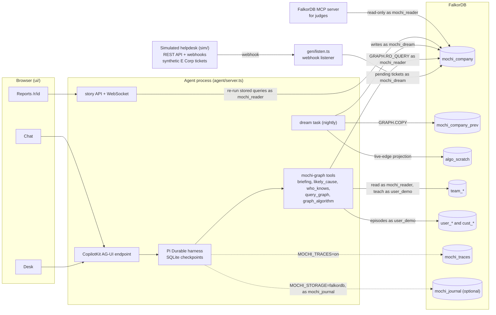

- **FalkorDB** holds all memory and context. Hand-written Cypher, no ORM. Vector search uses FalkorDB's vector index on `Ticket.embedding` (1536-dim OpenAI `text-embedding-3-small`; a local 384-dim MiniLM is used only by tests). Remove FalkorDB and nothing works.
- **Pi Durable** (`@earendil-works/pi-durable`) is the agent harness. SQLite holds checkpoints and transcripts only, never memory. Read tools (`briefing`, `likely_cause`, `who_knows`, `emerging_clusters`, `blast_radius`, `search_similar`, `customer_profile`, `query_graph`, `graph_algorithm`, `build_story`, `render_html`) are replay-safe. Write tools (`record_resolution`, `teach`, `feedback`) are never silently repeated after a crash. User conversations do not get `record_resolution`.
- **CopilotKit chat** speaks AG-UI to an endpoint inside the agent process. Answers render as tool cards built by our code (numbers come from query rows, never from model tokens), then story tags, then sandboxed HTML as a last resort with no literal digits.
- **`/story` and `/dashboard`** in chat make a draft report: markdown plus `query_id` tags, so every number is a stored query. Publish gives it a link.
- **The simulated helpdesk** (`sim/`) is a fictional, Freshdesk-shaped ticketing system with about 3,000 E Corp Securities tickets and mail threads: follow-ups, duplicates, merges, CCs, auto-replies, bounces, Hinglish. It posts webhooks on a replay clock and keeps its ground truth in a file it never serves. The graph, the eval and the benchmark all come from that one source.

<details><summary><b>FalkorDB as the harness journal</b> (<code>MOCHI_STORAGE=falkordb</code>)</summary>

`agent/storage/falkordb.ts` implements Pi Durable's `Storage` interface on the `mochi_journal` graph, so FalkorDB becomes the only datastore. Each commit batch is one parameterised write (`UNWIND` inside `CALL {}`), atomic in FalkorDB; a `Journal` counter node issues the commit sequence in the same query. Conversations fork as `(:Conversation)-[:FORKED_FROM {at}]->(:Conversation)`. Provenance edges: `Entry-[:IN]->Conversation`, `Entry-[:CALLS]->Task`, `Entry-[:BY_TASK]->Task`, `Submission-[:TO]->Conversation`, `Entry-[:WROTE]->Revision-[:OF]->Document`. The `trace_story` tool walks them as `mochi_reader`, which may read `~mochi_journal` and never write it. Production must run `--appendfsync always`. The upstream storage conformance suite passes against it (`agent/storage/falkordb.test.ts`).

</details>

## How a brief is built

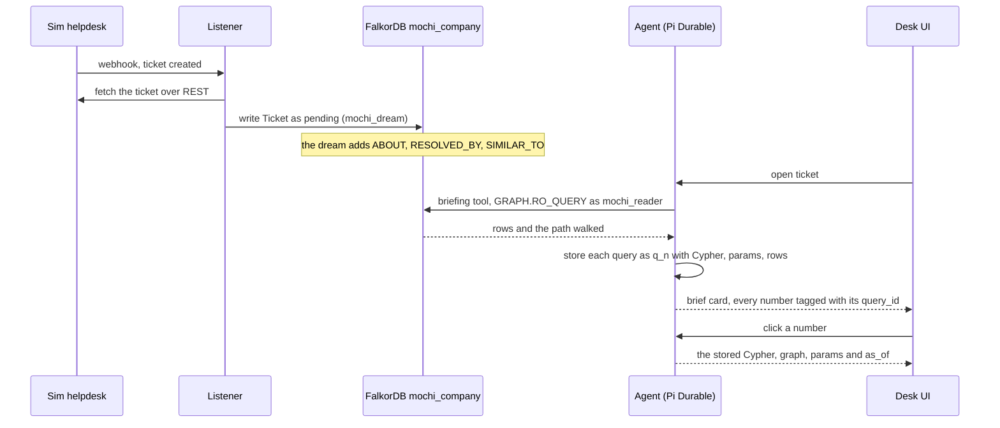

The core path is `Ticket -ABOUT-> Issue <-ABOUT- Ticket -RESOLVED_BY-> Resolution -BASED_ON-> KBArticle` (`briefing.similar` below), plus `Release -INTRODUCED-> Issue` for the likely cause and `AgentUser -SOLVED-> Ticket` for who knows.

## The nightly dream

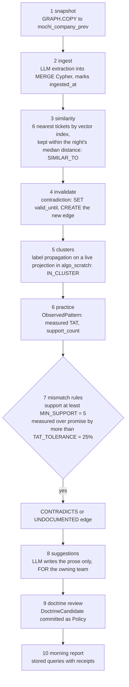

Runs on a timer (`MOCHI_DREAM_EVERY_MS`, default 24 h), with `npm run dream`, or `POST /api/dream/run`. The mismatch rules are arithmetic and Cypher, no LLM. A workaround used often but in no KB article becomes `UNDOCUMENTED`. Teachings from chat land as `DoctrineCandidate` nodes and are committed as `Policy` with `taught_by` and `source_session`. The dream's cluster step runs label propagation over the last seven days' `Ticket-ABOUT-Issue` pairs projected into `algo_scratch`; the `communities` algorithm tool and the clusters benchmark run it over live `SIMILAR_TO` edges.

## Graph data model

Source of truth: [`contracts/graph.ts`](contracts/graph.ts). The loader, the dream, the agent queries and the bench all import names from it.

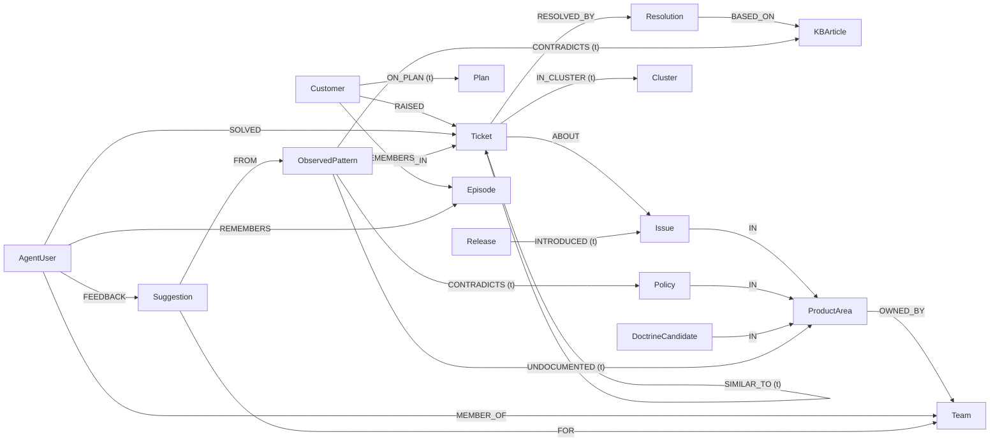

`(t)` marks temporal edges. Doctrine (what the company claims) lives on `KBArticle` and `Policy` (`promised_tat_hours`, `steps`). Practice (what happens) lives on `ObservedPattern` (`measured_tat_hours`, `support_count`, `last_seen`), which the dream distills from tickets. Every node carries `source` (`seed`, `dream`, `teach`, `session`) and `created_at`, plus provenance such as `source_ticket` or `source_session`.

| edge | from | to | temporal |
|---|---|---|---|
| `RAISED` | Customer | Ticket | |
| `ON_PLAN` | Customer | Plan | yes |
| `ABOUT` | Ticket | Issue | |
| `IN` | Issue, DoctrineCandidate, Policy | ProductArea | |
| `OWNED_BY` | ProductArea | Team | |
| `SOLVED` | AgentUser | Ticket | |
| `MEMBER_OF` | AgentUser | Team | |
| `RESOLVED_BY` | Ticket | Resolution | |
| `BASED_ON` | Resolution | KBArticle | |
| `INTRODUCED` | Release | Issue | yes |
| `FOLLOWS` | Ticket | Ticket | |
| `MERGED_INTO` | Ticket | Ticket (primary) | |
| `SIMILAR_TO` | Ticket | Ticket (dream-built kNN over embeddings) | yes |
| `CONTRADICTS` | ObservedPattern | KBArticle, Policy | yes |
| `UNDOCUMENTED` | ObservedPattern | ProductArea | yes |
| `SEEN_IN` | ObservedPattern | Ticket | |
| `FROM` | Suggestion | ObservedPattern | |
| `FOR` | Suggestion | Team | |
| `FEEDBACK` | AgentUser | Suggestion | |
| `IN_CLUSTER` | Ticket | Cluster | yes |
| `REMEMBERS` | Customer, AgentUser | Episode (in `cust_*` / `user_*` graphs) | |

### The temporal rule

Every mutable fact is an edge with `valid_from` and `valid_until` (epoch ms). FalkorDB cannot store null, so a live fact has `valid_until = VALID_FOREVER = 253402300799000` (9999-12-31). A contradiction never edits or deletes: it runs `SET old.valid_until = $as_of` and `CREATE`s a new edge. One filter serves live and past reads; live reads pass `$as_of = now`:

```text
EDGE_AS_OF(r) = r.valid_from <= $as_of AND r.valid_until > $as_of
NODE_AS_OF(n) = n.created_at <= $as_of
```

Every temporal edge type has a range index on `valid_until`.

## Memory tiers and isolation

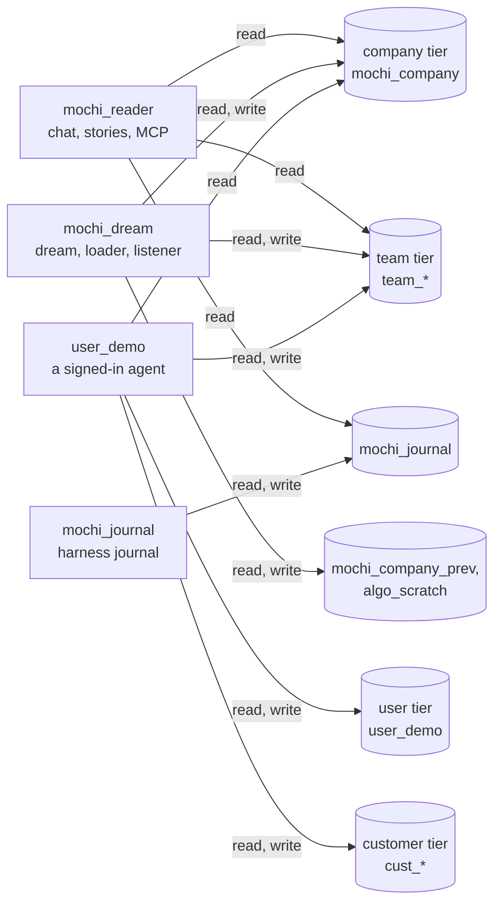

| graph | what it holds | who writes |
|---|---|---|
| `mochi_company` | the company brain | only `mochi_dream` (dream, loader, listener); append-only, facts retired by `valid_until` |
| `mochi_company_prev` | `GRAPH.COPY` of the brain before each dream | `mochi_dream` |
| `algo_scratch` | live-edge projection for algorithms (they ignore edge properties) | `mochi_dream` |
| `team_<slug>` | shared team memory (teachings, doctrine candidates) | that team's members |
| `user_<id>` | personal memory and preferences | that user only |
| `cust_<id>` | per-customer episodic memory | user conversations |
| `mochi_traces` | decision traces (`MOCHI_TRACES=on`) | the harness |
| `mochi_journal` | harness journal (`MOCHI_STORAGE=falkordb`) | `mochi_journal` only |

The company graph wins on facts, user graphs win on preferences. ACL rules live in `docker-compose.yml` and are checked against `contracts/graph.ts` by a test. Grants are per command (`%R~` is never used because it blocks `GRAPH.RO_QUERY`). A prompt-injected write from a user conversation fails at FalkorDB with `NOPERM`.

## Decision traces

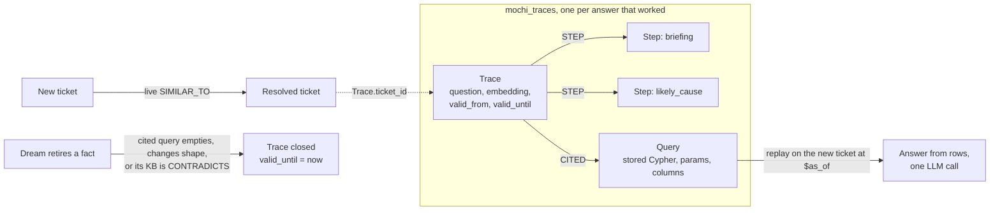

For a new ticket Mochi looks up similar resolved tickets through live `SIMILAR_TO` edges (vector index as fallback), finds their traces, and replays the stored queries on the new ticket, so the model reads rows instead of exploring. Every cited query is re-checked against the company graph at the current `$as_of`; a trace whose receipts no longer hold is closed and never offered again. Off by default (`MOCHI_TRACES=on`).

## Benchmarks

```sh
npm run bench                     # everything, from the seed
npm run bench -- --only main      # one section: main, staleness, ablation, clusters, concurrency, isolation, server
```

`--dry` spends nothing and writes `artifacts/results.dry.json`; `--max-usd 25` caps spend. Output: `bench/results.json`, the only source of published figures. The charts and tables below are regenerated from it by `node scripts/readme-charts.ts`, and `npm run check` fails if they drift.

<!-- bench:method (generated by scripts/readme-charts.ts, do not edit) -->
**Method.** 50 questions (20 single-fact, 20 multi-hop, 10 structural), seed 42, 500 answers on Haiku plus the same 50 per arm on Sonnet in `per_task`. Judge: claude-opus-5-5 (`bench/judge.md`, not the answer model). Run at 2026-10-18T10:25:59.413Z.
<!-- /bench:method -->

Arms: **A** everything in the prompt, **B** vector top-k (FalkorDB vector index, edges ignored), **C** markdown file memory (the open Agent Memory Repo spec), **D** the graph (the queries below), **E** the same data in SQLite with the same tools plus `query_sql`. **F** (TencentDB Agent Memory) is not measured: its extraction runs in a separate HTTP gateway that bypasses our cost meter and spend cap, so its tokens could not be counted honestly (`bench/artifacts/arm-f.md`). Single-fact answers are scored by exact match; multi-hop and structural by the judge (`bench/judge.md`). Tokens come from the provider's usage field.

### Accuracy and cost

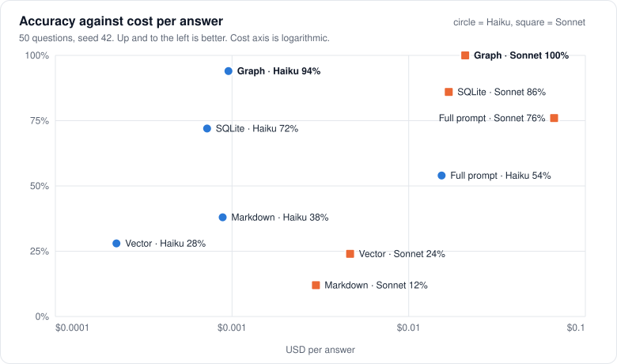

<!-- bench:accuracy (generated by scripts/readme-charts.ts, do not edit) -->
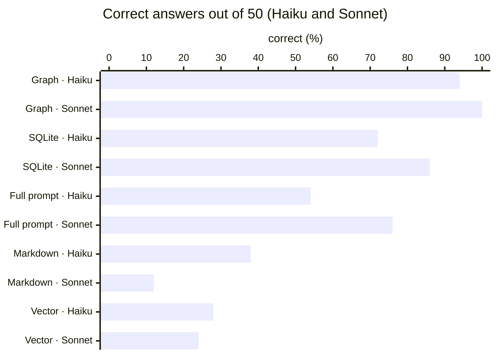

| memory design | Haiku correct | Haiku $/answer | Sonnet correct | Sonnet $/answer |
|---|---|---|---|---|
| Graph (D) | 94% | $0.00095 | 100% | $0.021 |
| SQLite, same tools (E) | 72% | $0.00072 | 86% | $0.017 |
| Everything in prompt (A) | 54% | $0.015 | 76% | $0.067 |
| Markdown notes (C) | 38% | $0.00089 | 12% | $0.003 |
| Vector search (B) | 28% | $0.00022 | 24% | $0.0047 |
<!-- /bench:accuracy -->

<!-- bench:cost (generated by scripts/readme-charts.ts, do not edit) -->
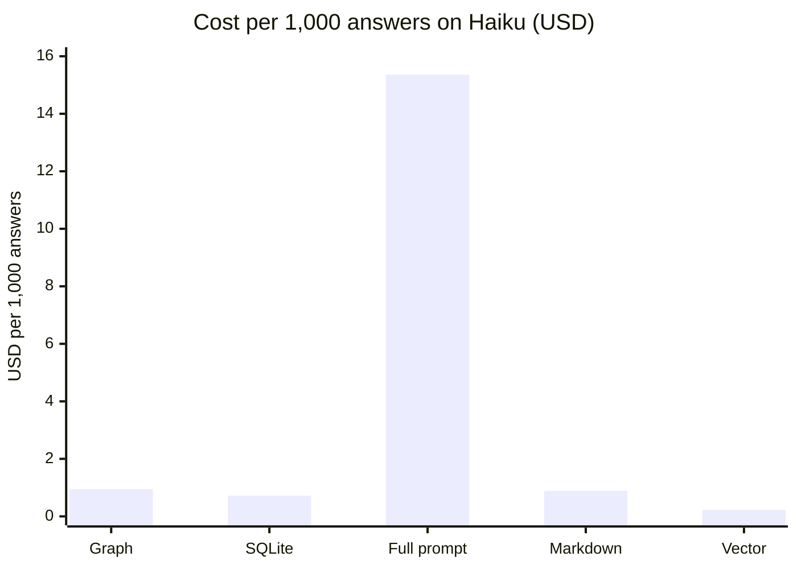
<!-- /bench:cost -->

### By question type

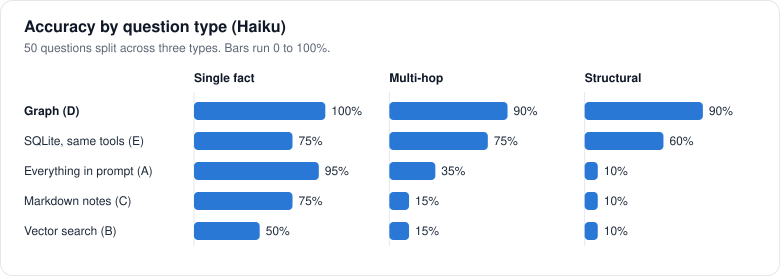

### Staying current

<!-- bench:staleness (generated by scripts/readme-charts.ts, do not edit) -->
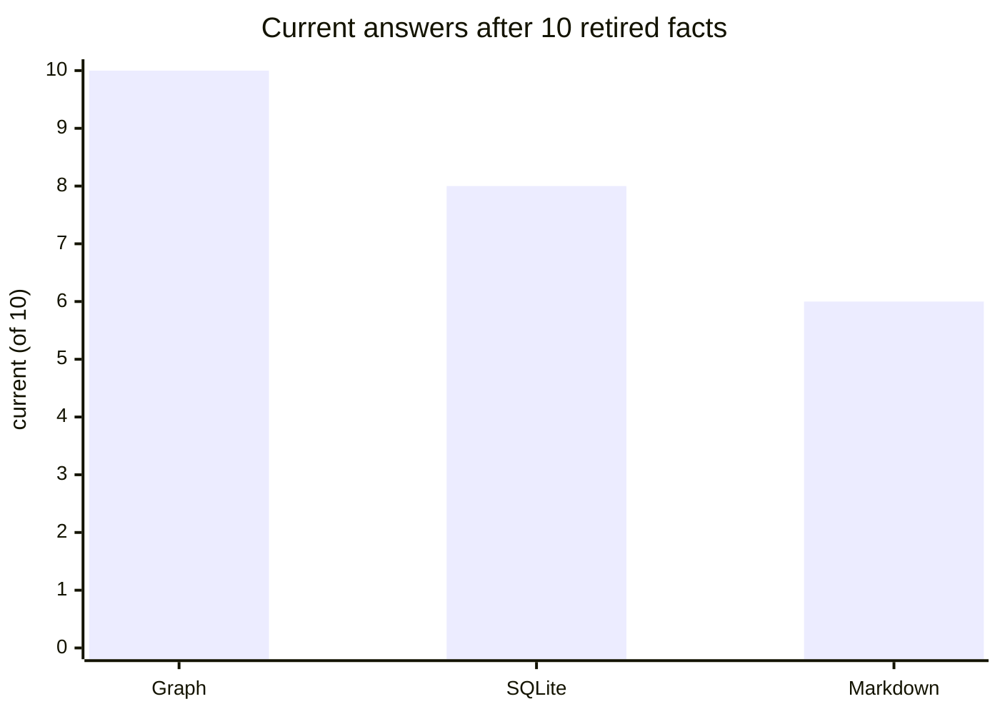

Mean upkeep per change: the graph 0 tokens, SQLite with the same tools 0 tokens, markdown notes 36,886 tokens. The graph retires an edge with one Cypher write; markdown notes are rewritten by the model.
<!-- /bench:staleness -->

### Learning from past tickets (decision traces)

Learn from 40 earlier resolved tickets, then answer 40 later, unseen ones; every approach gets the same facts per lesson. Then retire 10 facts and check whether stale fixes come back. "Devin-style Knowledge" is modelled on Devin's documented Knowledge feature, not Devin itself.

<!-- bench:traces (generated by scripts/readme-charts.ts, do not edit) -->
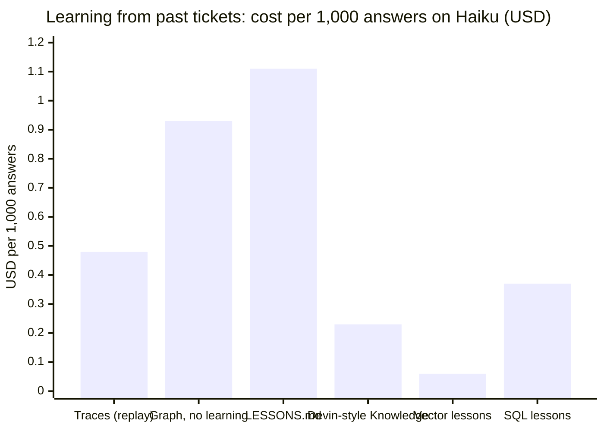

| approach | correct (of 40) | $/answer | p50 | current after retirements |
|---|---|---|---|---|
| Graph decision traces (replay) | 39 | $0.00048 | 1.32 s | 9/10 |
| Graph memory, no learning | 40 | $0.00093 | 1.97 s | 10/10 |
| Markdown + LESSONS.md | 40 | $0.0011 | 1.83 s | 0/10 |
| Devin-style Knowledge (modelled) | 30 | $0.00023 | 1.84 s | 0/10 |
| Vector lessons | 29 | $0.000059 | 1.33 s | 0/10 |
| SQL lessons | 28 | $0.00037 | 2.27 s | 0/10 |
<!-- /bench:traces -->

### Graph against the model alone

The doctrine-vs-practice job (5 planted mismatches) and the clusters job (planted bad-release spikes), each run as Cypher over the graph and by giving the model the same raw text.

<!-- bench:ablation (generated by scripts/readme-charts.ts, do not edit) -->
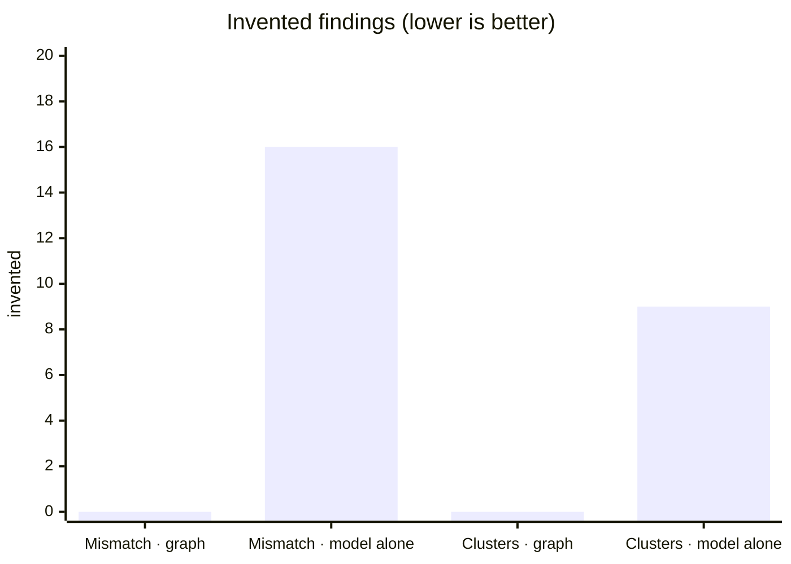

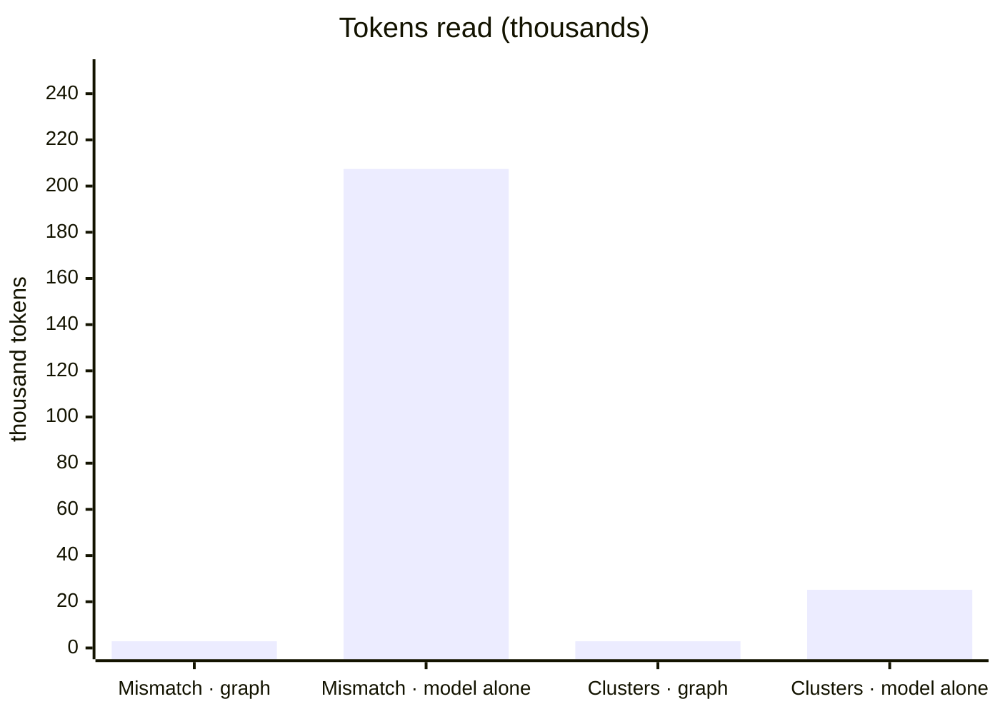

Both found 5/5 planted mismatches and 5/7 planted spikes. The difference is what else they reported and what they read.
<!-- /bench:ablation -->

### Where the graph lost

<!-- bench:lost (generated by scripts/readme-charts.ts, do not edit) -->
Per answer on Haiku, SQLite with the same tools ($0.00072), markdown notes ($0.00089), vector search ($0.00022) are cheaper than the graph ($0.00095). They answer fewer questions right. Sonnet on the graph scored 100% against Haiku's 94%, at $0.021 per answer. Decision traces gave up 1 answer (39/40 against 40/40) and 1 fresh answer (9/10 against 10/10). The graph and the model alone each missed 2 of 7 planted spikes. Concurrency is one container on one machine with synthetic load, not a production cluster.
<!-- /bench:lost -->

### Feature Ledger

Every graph feature has a row, good or bad. A row that says "not measured" says so in public.

<!-- ledger:start (generated by scripts/readme-cypher.ts, do not edit) -->
Source: `bench/results.json`, run at 2026-10-18T10:25:59.413Z, seed 42.

| feature | graph mechanism | measured against | result | status |
|---|---|---|---|---|
| briefing retrieval | multi-hop Cypher | arms A/B/C/E (main benchmark; E = the same tools as SQLite SQL plus query_sql; E has no algorithm tools: SQLite has no PageRank/CDLP; paths only via recursive CTE through query_sql) | D 47/50 vs E 36/50 vs C 19/50 vs B 14/50 vs A 27/50 | measured |
| TencentDB Agent Memory comparison (arm F) | multi-hop Cypher | TencentDB Agent Memory, not integrated: its extraction runs in a separate HTTP gateway whose LLM calls bypass the bench meter and cost cap (bench/artifacts/arm-f.md) | not measured | not measured |
| mismatch detection | deterministic CONTRADICTS/UNDOCUMENTED rules | LLM given all docs+tickets as text; 5 planted mismatches | graph found 5/5, 0 hallucinated, 2862 tokens vs LLM found 5/5, 16 hallucinated, 207399 tokens | measured |
| emerging clusters | benchmark: community detection (CDLP) over SIMILAR_TO kNN edges, no seeded issue links read (the product's nightly clusters group tickets by issue); dream tokens counted, embedding tokens not | LLM clustering of the same week's raw ticket text vs planted bad-release spikes | graph 5/7 spikes, 0 spurious, 2854 tokens vs LLM 5/7 spikes, 9 spurious, 25219 tokens | measured |
| crash resume | Pi Durable checkpoints | demonstrated, not benchmarked | demonstrated by agent/scripts/crash-demo.ts, not benchmarked | demonstrated |
| tier isolation | Redis ACL users per tier | refusal cases as mochi_reader | 4/4 refused as mochi_reader | measured |
| multi-agent concurrency | N parallel briefings while the dream writes; multigraph isolation | latency p50/p95 vs N, torn-read assertion, one graph vs per-user graphs | N=25: p50 7.8ms, p95 10.24ms, 2028.74/s; torn reads 0 across N=1/5/10/25; readers p95 one graph 9.15ms vs per-user 6.82ms (single container, admin user on a scratch copy) | measured |
| decision traces | mochi_traces Trace/Step/Query graph, Trace.embedding vector index, SIMILAR_TO-first ticket lookup, receipts re-checked at as_of | learning-from-past-tickets approaches on the same 40 later tickets, lessons from the same 40 earlier resolved tickets (bench/arms/lessons.ts); staleness after 10 retirements | D 40/40, $0.000926/task, 8835/85 tok, 2 LLM calls, p50 1971ms, fresh 10/10; graph traces (warm replay) 39/40, $0.000482/task, 4738/16 tok, 1 LLM calls, p50 1323ms, fresh 9/10; file memory C 40/40, $0.000767/task + $0.159 dream once, 7547/26 tok, 2 LLM calls, p50 1818ms; C + LESSONS.md 40/40, $0.001113/task, 10972/31 tok, 2 LLM calls, p50 1829ms, fresh 0/10 (stale resurfaced 10); Devin-style Knowledge (modelled on Devin's documented Knowledge feature, not Devin itself) 30/40, $0.000233/task, 1965/73 tok, 2 LLM calls, p50 1842ms, fresh 0/10 (stale resurfaced 8); vector lessons top-3 29/40, $0.000059/task, 530/11 tok, 2 LLM calls, p50 1332ms, fresh 0/10 (stale resurfaced 10); SQL lessons 28/40, $0.000366/task, 2644/202 tok, 2 LLM calls, p50 2266ms, fresh 0/10 (stale resurfaced 8) | measured |
<!-- ledger:end -->

## Setup from a clean clone

Needs Node 24+ and Docker.

```sh
cp .env.example .env          # set the passwords, ANTHROPIC_API_KEY and OPENAI_API_KEY
docker compose up -d          # FalkorDB 4.22.1 with the ACL users
npm install
npm run gen                   # seeded synthetic dataset -> data/dataset.json, data/eval.json
npm run load                  # writes the graph as mochi_dream
npm run check                 # typecheck + tests; run after npm run load (company-graph tests skip without it)
npm run dev                   # sim + listener + agent + desk UI
```

**Sign-in.** The platform (`/app`) and every `/api` route sit behind a login: user `admin`, password `admin@1234`. These are **demo credentials**: change them with `MOCHI_LOGIN_USER` / `MOCHI_LOGIN_PASSWORD` and set `MOCHI_SESSION_SECRET`. Open without signing in: the landing page, `/blog`, `POST /api/login`, `GET /api/health`, and reads of published stories and dashboards, so shared links keep working.

Tests create and drop throwaway graphs. Point them at your own FalkorDB, never a shared one (`FALKORDB_PORT` in `.env`).

| what | where |
|---|---|
| FalkorDB (Redis protocol) | `localhost:6379` |
| FalkorDB Browser | http://localhost:3000 (log in as `default` with `FALKORDB_PASSWORD`) |
| Agent server (`PORT`, default 4000) | http://localhost:4000 |
| CopilotKit / AG-UI chat endpoint | http://localhost:4000/api/copilotkit |
| Story API | `GET /api/stories/<id>?asOf=<epoch ms>`, live updates on `ws://…/api/stories/<id>/live` |
| Run the dream now | `POST /api/dream/run[?asOf=<epoch ms>]` (signed in, or `x-mochi-admin: $MOCHI_ADMIN_TOKEN`) |
| Desk UI | http://localhost:5173/app/ |
| Landing page | `npm run landing` |

Other scripts: `npm run dream` (one dream now; stop `npm run dev` first, since one process owns the SQLite), `npm run bench`, `npm run crash-demo -w agent`.

### Deploy (Railway)

The live demo runs on Railway as two services: FalkorDB from Railway's template, configured with the same ACL users as `docker-compose.yml`, and the app container from this repo's `Dockerfile` (agent, desk, landing page, blog, plus the internal sim helpdesk and listener). Steps, variables and the smoke test: [`deploy/railway.md`](deploy/railway.md).

## The Cypher the product depends on

Generated from the code by `scripts/readme-cypher.ts`; `node scripts/readme-cypher.ts --check` fails if this section drifts. `${EDGE_AS_OF}` and `${NODE_AS_OF}` are already expanded. Open any query to read it.

<!-- cypher:start (generated by scripts/readme-cypher.ts, do not edit) -->
### Agent queries

All read-only, run as `mochi_reader` through `GRAPH.RO_QUERY`, and every one filters on `$as_of`. Source: `agent/queries/index.ts`.

<details><summary><b>briefing.profile</b> · ticket → customer → live plan → issue</summary>

```cypher
/* mochi:briefing.profile@v1 */
MATCH (c:Customer)-[:RAISED]->(t:Ticket {id: $ticketId})
WHERE c.created_at <= $as_of AND t.created_at <= $as_of
OPTIONAL MATCH (c)-[op:ON_PLAN]->(p:Plan) WHERE op.valid_from <= $as_of AND op.valid_until > $as_of
OPTIONAL MATCH (t)-[:ABOUT]->(i:Issue) WHERE i.created_at <= $as_of
RETURN c.id AS customer_id, c.name AS name, c.segment AS segment, c.city AS city, p.name AS plan,
       t.subject AS ticket_subject, i.id AS issue_id
```

</details>
<details><summary><b>briefing.recent</b> · the customer's last three other tickets</summary>

```cypher
/* mochi:briefing.recent@v1 */
MATCH (c:Customer)-[:RAISED]->(:Ticket {id: $ticketId}), (c)-[r:RAISED]->(t:Ticket)
WHERE t.id <> $ticketId AND t.created_at <= $as_of
RETURN t.id AS ticket, t.subject AS subject, t.status AS status, t.created_at AS created_at
ORDER BY t.created_at DESC, t.id LIMIT 3
```

</details>
<details><summary><b>briefing.similar</b> · ticket → issue ← solved tickets → resolution → KB path</summary>

```cypher
/* mochi:briefing.similar@v1 path: graph */
MATCH (t:Ticket {id: $ticketId})-[:ABOUT]->(i:Issue)<-[:ABOUT]-(s:Ticket)-[:RESOLVED_BY]->(r:Resolution)
WHERE s.id <> t.id AND t.created_at <= $as_of AND i.created_at <= $as_of AND s.created_at <= $as_of AND r.created_at <= $as_of AND s.resolved_at <= $as_of
OPTIONAL MATCH (r)-[:BASED_ON]->(k:KBArticle) WHERE k.created_at <= $as_of
RETURN s.id AS ticket, s.subject AS subject, i.id AS issue_id, i.name AS issue,
       r.id AS resolution_id, r.summary AS resolution, k.id AS kb_id, k.title AS kb
ORDER BY s.resolved_at DESC, s.id LIMIT 5
```

</details>
<details><summary><b>briefing.similarVector</b> · vector neighbours → resolution → KB (fallback path)</summary>

```cypher
/* mochi:briefing.similar@v1 path: vector→graph */
MATCH (t:Ticket {id: $ticketId})
CALL db.idx.vector.queryNodes('Ticket', 'embedding', $k, t.embedding) YIELD node, score
WITH t, node AS s, score
WHERE s.id <> t.id AND s.created_at <= $as_of AND s.resolved_at <= $as_of
MATCH (s)-[:RESOLVED_BY]->(r:Resolution) WHERE r.created_at <= $as_of
OPTIONAL MATCH (s)-[:ABOUT]->(i:Issue)
OPTIONAL MATCH (r)-[:BASED_ON]->(k:KBArticle) WHERE k.created_at <= $as_of
RETURN s.id AS ticket, s.subject AS subject, i.id AS issue_id, i.name AS issue,
       r.id AS resolution_id, r.summary AS resolution, k.id AS kb_id, k.title AS kb, score
ORDER BY score, s.id LIMIT 5
```

</details>
<details><summary><b>briefing.suggestions</b> · open doctrine-vs-practice suggestions for the owning team</summary>

```cypher
/* mochi:briefing.suggestions@v1 */
MATCH (t:Ticket {id: $ticketId})-[:ABOUT]->(i:Issue)-[:IN]->(a:ProductArea)-[:OWNED_BY]->(tm:Team)<-[:FOR]-(s:Suggestion)-[:FROM]->(p:ObservedPattern)-[e:CONTRADICTS|UNDOCUMENTED]->(d)
WHERE s.area = a.name AND s.status = 'open' AND s.expires_at > $as_of AND t.created_at <= $as_of AND s.created_at <= $as_of AND e.valid_from <= $as_of AND e.valid_until > $as_of
RETURN DISTINCT s.id AS suggestion_id, type(e) AS edge, coalesce(d.id, d.name) AS target, a.name AS area, tm.name AS team,
       s.text AS text, s.support_count AS support, p.measured_tat_hours AS measured, e.promised AS promised, s.confidence AS confidence
ORDER BY confidence DESC, suggestion_id LIMIT 2
```

</details>
<details><summary><b>likelyCause</b> · ticket → issue ← release that introduced it (live edge)</summary>

```cypher
/* mochi:likely_cause@v1 */
MATCH (t:Ticket {id: $ticketId})-[:ABOUT]->(i:Issue)<-[x:INTRODUCED]-(r:Release)
WHERE x.valid_from <= $as_of AND x.valid_until > $as_of AND t.created_at <= $as_of AND i.created_at <= $as_of AND r.created_at <= $as_of
RETURN t.id AS ticket, t.subject AS subject, i.id AS issue_id, i.name AS issue,
       r.version AS release, r.shipped_at AS shipped_at, x.valid_from AS introduced_at
ORDER BY r.shipped_at DESC, r.version LIMIT 3
```

</details>
<details><summary><b>whoKnows</b> · agents who solved this issue, with their team</summary>

```cypher
/* mochi:who_knows@v1 */
MATCH (i:Issue) WHERE (i.id = $issueId OR toLower(i.name) = toLower($issueId)) AND i.created_at <= $as_of
MATCH (a:AgentUser)-[s:SOLVED]->(t:Ticket)-[:ABOUT]->(i)
WHERE a.created_at <= $as_of AND t.created_at <= $as_of
WITH a, i, count(s) AS solved, min(t.id) AS example_ticket
OPTIONAL MATCH (a)-[:MEMBER_OF]->(tm:Team)
RETURN a.id AS agent_id, a.name AS agent, tm.name AS team, solved, example_ticket, i.name AS issue
ORDER BY solved DESC, agent_id LIMIT 5
```

</details>
<details><summary><b>whoKnowsIssues</b> · issue list for who-knows lookups</summary>

```cypher
/* mochi:who_knows.issues@v1 */
MATCH (i:Issue) WHERE i.created_at <= $as_of
RETURN i.id AS issue_id, i.name AS issue
ORDER BY issue_id
```

</details>
<details><summary><b>emergingClusters</b> · live clusters ranked by growth in a window</summary>

```cypher
/* mochi:emerging_clusters@v1 */
MATCH (t:Ticket)-[m:IN_CLUSTER]->(c:Cluster)
WHERE m.valid_from <= $as_of AND m.valid_until > $as_of AND c.created_at <= $as_of AND t.created_at <= $as_of
WITH c, count(m) AS tickets, sum(CASE WHEN t.created_at > $as_of - $window_ms THEN 1 ELSE 0 END) AS growth
RETURN c.id AS cluster, tickets, growth
ORDER BY growth DESC, tickets DESC, cluster LIMIT 10
```

</details>
<details><summary><b>blastRadius.segments</b> · release → issues → tickets → customers, by segment</summary>

```cypher
/* mochi:blast_radius.segments@v1 */
MATCH (r:Release {version: $version})-[x:INTRODUCED]->(i:Issue)<-[a:ABOUT]-(t:Ticket)<-[rz:RAISED]-(c:Customer)
WHERE x.valid_from <= $as_of AND x.valid_until > $as_of AND r.created_at <= $as_of AND i.created_at <= $as_of AND t.created_at <= $as_of AND c.created_at <= $as_of
RETURN c.segment AS segment, count(DISTINCT c) AS customers, count(DISTINCT t) AS tickets
ORDER BY customers DESC, segment
```

</details>
<details><summary><b>blastRadius.totals</b> · customers, tickets and open tickets hit by a release</summary>

```cypher
/* mochi:blast_radius.totals@v1 */
MATCH (r:Release {version: $version})-[x:INTRODUCED]->(i:Issue)<-[a:ABOUT]-(t:Ticket)<-[rz:RAISED]-(c:Customer)
WHERE x.valid_from <= $as_of AND x.valid_until > $as_of AND r.created_at <= $as_of AND i.created_at <= $as_of AND t.created_at <= $as_of AND c.created_at <= $as_of
RETURN count(DISTINCT c) AS customers, count(DISTINCT t) AS tickets,
       count(DISTINCT CASE WHEN t.resolved_at IS NULL OR t.resolved_at > $as_of THEN t END) AS open_tickets
```

</details>
<details><summary><b>blastRadius.affected</b> · the affected tickets and customers</summary>

```cypher
/* mochi:blast_radius.affected@v1 */
MATCH (r:Release {version: $version})-[x:INTRODUCED]->(i:Issue)<-[a:ABOUT]-(t:Ticket)<-[rz:RAISED]-(c:Customer)
WHERE x.valid_from <= $as_of AND x.valid_until > $as_of AND r.created_at <= $as_of AND i.created_at <= $as_of AND t.created_at <= $as_of AND c.created_at <= $as_of
RETURN c.id AS customer_id, c.name AS customer, c.segment AS segment, t.id AS ticket, t.subject AS subject,
       i.id AS issue_id, i.name AS issue,
       CASE WHEN t.resolved_at IS NULL OR t.resolved_at > $as_of THEN 'open' ELSE 'resolved' END AS state
ORDER BY t.created_at DESC, t.id LIMIT 10
```

</details>
<details><summary><b>blastRadius.owner</b> · release → issue → product area → owning team</summary>

```cypher
/* mochi:blast_radius.owner@v1 */
MATCH (r:Release {version: $version})-[x:INTRODUCED]->(i:Issue)-[:IN]->(a:ProductArea)-[:OWNED_BY]->(tm:Team)
WHERE x.valid_from <= $as_of AND x.valid_until > $as_of AND r.created_at <= $as_of AND i.created_at <= $as_of
RETURN tm.name AS team, a.name AS area, collect(DISTINCT i.name) AS issues
ORDER BY team, area LIMIT 3
```

</details>
<details><summary><b>searchSimilar</b> · free-text vector search over tickets</summary>

```cypher
/* mochi:search_similar@v1 */
CALL db.idx.vector.queryNodes('Ticket', 'embedding', $fetch, vecf32($vector)) YIELD node, score
WITH node AS t, score WHERE t.created_at <= $as_of
OPTIONAL MATCH (t)-[:ABOUT]->(i:Issue)
RETURN t.id AS ticket, t.subject AS subject, t.status AS status, i.name AS issue, score
ORDER BY score, ticket LIMIT $k
```

</details>
<details><summary><b>customerProfile.profile</b> · customer and live plan</summary>

```cypher
/* mochi:customer_profile.profile@v1 */
MATCH (c:Customer {id: $customerId}) WHERE c.created_at <= $as_of
OPTIONAL MATCH (c)-[op:ON_PLAN]->(p:Plan) WHERE op.valid_from <= $as_of AND op.valid_until > $as_of
RETURN c.id AS customer_id, c.name AS name, c.segment AS segment, p.name AS plan, c.city AS city
```

</details>
<details><summary><b>customerProfile.history</b> · closed tickets and how each ended</summary>

```cypher
/* mochi:customer_profile.history@v1 */
MATCH (c:Customer {id: $customerId})-[:RAISED]->(t:Ticket)
WHERE t.created_at <= $as_of AND t.status IN ['resolved', 'closed'] AND NOT (t)-[:MERGED_INTO]->(:Ticket)
OPTIONAL MATCH (t)-[:RESOLVED_BY]->(r:Resolution) WHERE r.created_at <= $as_of
RETURN t.id AS ticket, t.subject AS subject, t.created_at AS created_at, t.status AS status,
       r.kind AS resolution_kind, coalesce(r.summary, 'Closed with no recorded fix') AS ended
ORDER BY t.created_at DESC, t.id LIMIT 10
```

</details>
<details><summary><b>customerProfile.open</b> · open tickets</summary>

```cypher
/* mochi:customer_profile.open@v1 */
MATCH (c:Customer {id: $customerId})-[:RAISED]->(t:Ticket)
WHERE t.created_at <= $as_of AND NOT t.status IN ['resolved', 'closed']
RETURN t.id AS ticket, t.subject AS subject, t.created_at AS created_at, t.status AS status
ORDER BY t.created_at DESC, t.id LIMIT 10
```

</details>
<details><summary><b>customerProfile.merged</b> · duplicates merged into a primary ticket</summary>

```cypher
/* mochi:customer_profile.merged@v1 */
MATCH (c:Customer {id: $customerId})-[:RAISED]->(d:Ticket)-[:MERGED_INTO]->(p:Ticket)
WHERE d.created_at <= $as_of AND p.created_at <= $as_of
RETURN d.id AS ticket, d.subject AS subject, p.id AS merged_into
ORDER BY d.created_at DESC, d.id LIMIT 10
```

</details>
<details><summary><b>entity.customerActivity</b> · open tickets and last contact</summary>

```cypher
/* mochi:entity.customer_activity@v1 */
MATCH (c:Customer {id: $customerId})-[:RAISED]->(t:Ticket) WHERE t.created_at <= $as_of
WITH t ORDER BY t.created_at DESC, t.id
RETURN sum(CASE WHEN t.status IN ['resolved', 'closed'] THEN 0 ELSE 1 END) AS open_tickets,
       max(t.created_at) AS last_contact, head(collect(t.id)) AS latest_ticket
```

</details>
<details><summary><b>entity.ticket</b> · one ticket with customer and resolution</summary>

```cypher
/* mochi:entity.ticket@v1 */
MATCH (c:Customer)-[:RAISED]->(t:Ticket {id: $ticketId}) WHERE t.created_at <= $as_of
OPTIONAL MATCH (t)-[:RESOLVED_BY]->(r:Resolution) WHERE r.created_at <= $as_of
RETURN t.id AS ticket, t.subject AS subject, t.status AS status, t.created_at AS created_at,
       r.summary AS resolution, c.id AS customer_id, c.name AS customer
```

</details>
<details><summary><b>entity.kb</b> · KB article with owning team and promise</summary>

```cypher
/* mochi:entity.kb@v1 */
MATCH (k:KBArticle {id: $kbId}) WHERE k.created_at <= $as_of
OPTIONAL MATCH (a:ProductArea {name: k.area})-[:OWNED_BY]->(tm:Team)
RETURN k.id AS kb_id, k.title AS title, k.area AS area, tm.name AS team, k.promised_tat_hours AS promised_tat_hours
```

</details>
<details><summary><b>entity.search</b> · search box: tickets, customers, issues</summary>

```cypher
/* mochi:entity.search@v1 */
MATCH (t:Ticket) WHERE t.created_at <= $as_of AND toLower(t.id) CONTAINS $q
RETURN 'ticket' AS kind, t.id AS id, t.subject AS name ORDER BY t.created_at DESC, t.id LIMIT 8
UNION ALL
MATCH (c:Customer) WHERE c.created_at <= $as_of AND (toLower(c.id) CONTAINS $q OR toLower(c.name) CONTAINS $q)
RETURN 'customer' AS kind, c.id AS id, c.name AS name ORDER BY c.id LIMIT 8
UNION ALL
MATCH (i:Issue) WHERE i.created_at <= $as_of AND toLower(i.name) CONTAINS $q
RETURN 'issue' AS kind, i.id AS id, i.name AS name ORDER BY i.name, i.id LIMIT 8
```

</details>
<details><summary><b>deskGuess</b> · queue guess: each ticket's issue and best-supported fix</summary>

```cypher
/* mochi:desk.guess@v1 */
UNWIND $ids AS tid
MATCH (t:Ticket {id: tid}) WHERE t.created_at <= $as_of
OPTIONAL MATCH (t)-[:ABOUT]->(i:Issue) WHERE i.created_at <= $as_of
OPTIONAL MATCH (i)<-[:ABOUT]-(s:Ticket)-[:RESOLVED_BY]->(r:Resolution)
WHERE s.id <> t.id AND s.created_at <= $as_of AND r.created_at <= $as_of AND s.resolved_at <= $as_of
WITH t, i, r, count(s) AS support
ORDER BY support DESC, r.id
WITH t, i, collect(CASE WHEN r IS NULL THEN null ELSE [r.id, r.summary, support] END) AS fixes, sum(support) AS resolved
RETURN t.id AS ticket, t.ingested_at IS NOT NULL AS ingested, i.id AS issue_id, i.name AS issue,
       fixes[0][0] AS resolution_id, fixes[0][1] AS resolution, coalesce(fixes[0][2], 0) AS support_count, resolved,
       CASE WHEN resolved > 0 THEN toFloat(fixes[0][2]) / resolved ELSE null END AS confidence
ORDER BY ticket, issue_id
```

</details>
<details><summary><b>deskCounts</b> · desk header counts: ingested, pending, clusters, retired, mismatches</summary>

```cypher
/* mochi:desk.counts@v1 */
OPTIONAL MATCH (t:Ticket) WHERE t.ingested_at > $as_of - $window_ms AND t.ingested_at <= $as_of
WITH count(t) AS ingested
OPTIONAL MATCH (p:Ticket) WHERE p.created_at <= $as_of AND p.ingested_at IS NULL
WITH ingested, count(p) AS pending
OPTIONAL MATCH (:Ticket)-[m:IN_CLUSTER]->(c:Cluster) WHERE m.valid_from <= $as_of AND m.valid_until > $as_of
WITH ingested, pending, count(DISTINCT c) AS clustered
OPTIONAL MATCH ()-[x]->() WHERE x.valid_until > $as_of - $window_ms AND x.valid_until <= $as_of
WITH ingested, pending, clustered, count(x) AS retired
OPTIONAL MATCH (:ObservedPattern)-[y:CONTRADICTS|UNDOCUMENTED]->() WHERE y.valid_from <= $as_of AND y.valid_until > $as_of
RETURN ingested, pending, clustered, retired, count(y) AS mismatches
```

</details>

### Dream queries

The dream, as `mochi_dream`, is the only writer of `mochi_company`; changed facts are retired with `valid_until`, never deleted. Source: `agent/dream/cypher.ts`.

<details><summary><b>pendingTickets</b> · tickets the dream has not ingested yet</summary>

```cypher
MATCH (t:Ticket) WHERE t.ingested_at IS NULL AND t.created_at <= $as_of
OPTIONAL MATCH (t)-[:ABOUT]->(i:Issue)
OPTIONAL MATCH (t)-[:RESOLVED_BY]->(res:Resolution)
RETURN t.id AS id, t.subject AS subject, t.body AS body, t.status AS status, i.id AS issue_id, res.id AS res_id
ORDER BY t.id
```

</details>
<details><summary><b>areas</b> · product areas for extraction</summary>

```cypher
MATCH (a:ProductArea) RETURN a.name AS name
```

</details>
<details><summary><b>issues</b> · known issues for extraction</summary>

```cypher
MATCH (i:Issue)-[:IN]->(a:ProductArea) RETURN i.id AS id, i.name AS name, a.name AS area, i.created_at AS created_at ORDER BY i.created_at DESC, i.id
```

</details>
<details><summary><b>ingestBatch</b> · MERGE extracted issues and resolutions, mark tickets ingested</summary>

```cypher
UNWIND $rows AS r
MATCH (t:Ticket {id: r.ticket_id}) WHERE t.ingested_at IS NULL
MATCH (a:ProductArea {name: r.area})
MERGE (i:Issue {id: r.issue_id})
ON CREATE SET i.name = r.issue_name, i.first_seen = t.created_at, i.created_at = $as_of, i.source = 'dream', i.source_ticket = r.ticket_id
MERGE (i)-[:IN]->(a)
MERGE (t)-[:ABOUT]->(i)
SET t.ingested_at = $as_of, t.batch_id = $batch_id, t.batch_size = $batch_size
WITH t, r
FOREACH (_ IN CASE WHEN r.res_kind <> '' THEN [1] ELSE [] END |
  MERGE (res:Resolution {id: r.res_id})
  ON CREATE SET res.kind = r.res_kind, res.summary = r.res_summary, res.created_at = $as_of, res.source = 'dream', res.source_ticket = r.ticket_id
  MERGE (t)-[:RESOLVED_BY]->(res))
WITH t, r
FOREACH (_ IN CASE WHEN r.issue2_id <> '' THEN [1] ELSE [] END |
  MERGE (a2:ProductArea {name: r.area2})
  MERGE (i2:Issue {id: r.issue2_id})
  ON CREATE SET i2.name = r.issue2_name, i2.first_seen = t.created_at, i2.created_at = $as_of, i2.source = 'dream', i2.source_ticket = r.ticket_id
  MERGE (i2)-[:IN]->(a2)
  MERGE (t)-[x:ABOUT]->(i2)
  ON CREATE SET x.source = 'dream', x.created_at = $as_of, x.batch_id = $batch_id, x.second_issue = true)
RETURN count(t) AS written
```

</details>
<details><summary><b>knn</b> · six nearest tickets by vector index</summary>

```cypher
UNWIND $ids AS id
MATCH (t:Ticket {id: id}) WHERE t.embedding IS NOT NULL AND t.created_at <= $as_of
CALL db.idx.vector.queryNodes('Ticket', 'embedding', 7, t.embedding) YIELD node, score
WITH t, node, score WHERE node <> t AND node.created_at <= $as_of
RETURN t.id AS a, node.id AS b, score ORDER BY a, score, b
```

</details>
<details><summary><b>ticketIds</b> · tickets to embed and link</summary>

```cypher
MATCH (t:Ticket) WHERE t.created_at <= $as_of RETURN t.id AS id ORDER BY id
```

</details>
<details><summary><b>liveSimilar</b> · current SIMILAR_TO edges</summary>

```cypher
MATCH (a:Ticket)-[s:SIMILAR_TO]->(b:Ticket) WHERE s.valid_from <= $as_of AND s.valid_until > $as_of RETURN a.id AS a, b.id AS b
```

</details>
<details><summary><b>retireSimilar</b> · close SIMILAR_TO edges that dropped out</summary>

```cypher
UNWIND $rows AS r
MATCH (:Ticket {id: r.a})-[s:SIMILAR_TO]->(:Ticket {id: r.b}) WHERE s.valid_from <= $as_of AND s.valid_until > $as_of
SET s.valid_until = $as_of
RETURN count(s) AS retired
```

</details>
<details><summary><b>createSimilar</b> · create new temporal SIMILAR_TO edges</summary>

```cypher
UNWIND $rows AS r
MATCH (a:Ticket {id: r.a}), (b:Ticket {id: r.b})
CREATE (a)-[s:SIMILAR_TO {score: r.score, valid_from: $as_of, valid_until: 253402300799000, source: 'dream', created_at: $as_of}]->(b)
RETURN count(s) AS created
```

</details>
<details><summary><b>windowPairs</b> · last 7 days' ticket → issue pairs for clustering</summary>

```cypher
MATCH (t:Ticket)-[:ABOUT]->(i:Issue)
WHERE t.created_at > $as_of - 604800000 AND t.created_at <= $as_of AND i.created_at <= $as_of
RETURN t.id AS t, i.id AS i, i.name AS name ORDER BY t.id, i.id
```

</details>
<details><summary><b>projectPairs</b> · project those pairs into algo_scratch</summary>

```cypher
UNWIND $rows AS r MERGE (t:Ticket {id: r.t}) MERGE (i:Issue {id: r.i}) MERGE (t)-[:ABOUT]->(i)
```

</details>
<details><summary><b>labelPropagation</b> · label propagation on the projection</summary>

```cypher
CALL algo.labelPropagation({nodeLabels: ['Ticket', 'Issue'], relationshipTypes: ['ABOUT'], maxIterations: 10}) YIELD node, communityId
WITH node, communityId WHERE node:Ticket
RETURN communityId, node.id AS id ORDER BY id
```

</details>
<details><summary><b>retireClusterEdges</b> · close IN_CLUSTER edges for tickets that moved</summary>

```cypher
UNWIND $rows AS r
MATCH (t:Ticket {id: r.t})-[old:IN_CLUSTER]->(oc:Cluster)
WHERE old.valid_from <= $as_of AND old.valid_until > $as_of AND oc.id <> r.c
SET old.valid_until = $as_of
RETURN count(old) AS retired
```

</details>
<details><summary><b>createClusterEdges</b> · create new IN_CLUSTER edges</summary>

```cypher
UNWIND $rows AS r
MATCH (t:Ticket {id: r.t})
MERGE (c:Cluster {id: r.c})
ON CREATE SET c.name = r.name, c.created_at = $as_of, c.source = 'dream', c.source_ticket_ids = r.members
WITH t, c
OPTIONAL MATCH (t)-[cur:IN_CLUSTER]->(c) WHERE cur.valid_from <= $as_of AND cur.valid_until > $as_of
WITH t, c, count(cur) AS live WHERE live = 0
CREATE (t)-[e:IN_CLUSTER {valid_from: $as_of, valid_until: 253402300799000, source: 'dream', created_at: $as_of}]->(c)
RETURN count(e) AS created
```

</details>
<details><summary><b>kbResolved</b> · measured resolution times per KB article</summary>

```cypher
MATCH (t:Ticket)-[:RESOLVED_BY]->(:Resolution)-[:BASED_ON]->(kb:KBArticle), (t)-[:ABOUT]->(i:Issue)-[:IN]->(a:ProductArea)
WHERE t.resolved_at IS NOT NULL AND t.resolved_at <= $as_of AND t.created_at <= $as_of
RETURN kb.id AS target, i.id AS issue, a.name AS area, kb.promised_tat_hours AS promised, t.id AS tid, t.created_at AS created, t.resolved_at AS resolved
ORDER BY tid
```

</details>
<details><summary><b>policyResolved</b> · measured resolution times per policy</summary>

```cypher
MATCH (p:Policy)-[:IN]->(a:ProductArea)<-[:IN]-(:Issue)<-[:ABOUT]-(t:Ticket)<-[:RAISED]-(c:Customer)
WHERE p.promised_tat_hours IS NOT NULL AND p.created_at <= $as_of AND t.resolved_at IS NOT NULL AND t.resolved_at <= $as_of
  AND (p.priority IS NULL OR t.priority = p.priority) AND (p.segment IS NULL OR c.segment = p.segment)
RETURN p.id AS target, a.name AS area, p.promised_tat_hours AS promised, t.id AS tid, t.created_at AS created, t.resolved_at AS resolved
ORDER BY tid
```

</details>
<details><summary><b>workarounds</b> · workarounds used with no KB article</summary>

```cypher
MATCH (t:Ticket)-[:RESOLVED_BY]->(res:Resolution), (t)-[:ABOUT]->(:Issue)-[:IN]->(a:ProductArea)
WHERE res.kind = 'workaround' AND NOT (res)-[:BASED_ON]->(:KBArticle) AND t.created_at <= $as_of
RETURN a.name AS area, res.summary AS summary, t.id AS tid, t.created_at AS created
ORDER BY tid
```

</details>
<details><summary><b>writePatterns</b> · write ObservedPattern nodes with SEEN_IN evidence</summary>

```cypher
UNWIND $rows AS r
MERGE (p:ObservedPattern {id: r.id})
ON CREATE SET p.key = r.key, p.kind = r.kind, p.run_id = $run, p.area = r.area, p.summary = r.summary,
  p.measured_tat_hours = r.measured, p.support_count = r.support, p.last_seen = r.last_seen,
  p.source = 'dream', p.created_at = $as_of, p.source_ticket_ids = r.tickets
WITH p, r
UNWIND r.tickets AS tid
MATCH (t:Ticket {id: tid})
MERGE (p)-[:SEEN_IN]->(t)
```

</details>
<details><summary><b>retireMismatches</b> · close last run's mismatch edges</summary>

```cypher
MATCH (o:ObservedPattern)-[e:CONTRADICTS|UNDOCUMENTED]->()
WHERE o.run_id <> $run AND e.valid_from <= $as_of AND e.valid_until > $as_of
SET e.valid_until = $as_of
RETURN count(e) AS retired
```

</details>
<details><summary><b>contradictsKB</b> · pattern CONTRADICTS a KB article</summary>

```cypher
UNWIND $rows AS r
MATCH (p:ObservedPattern {id: r.pid}), (d:KBArticle {id: r.target})
MERGE (p)-[c:CONTRADICTS]->(d)
ON CREATE SET c.delta = r.delta, c.promised = r.promised, c.measured = r.measured, c.valid_from = $as_of, c.valid_until = 253402300799000, c.source = 'dream', c.created_at = $as_of
RETURN count(c) AS n
```

</details>
<details><summary><b>contradictsPolicy</b> · pattern CONTRADICTS a policy</summary>

```cypher
UNWIND $rows AS r
MATCH (p:ObservedPattern {id: r.pid}), (d:Policy {id: r.target})
MERGE (p)-[c:CONTRADICTS]->(d)
ON CREATE SET c.delta = r.delta, c.promised = r.promised, c.measured = r.measured, c.valid_from = $as_of, c.valid_until = 253402300799000, c.source = 'dream', c.created_at = $as_of
RETURN count(c) AS n
```

</details>
<details><summary><b>undocumented</b> · pattern UNDOCUMENTED in a product area</summary>

```cypher
UNWIND $rows AS r
MATCH (p:ObservedPattern {id: r.pid}), (a:ProductArea {name: r.area})
MERGE (p)-[u:UNDOCUMENTED]->(a)
ON CREATE SET u.support_count = r.support, u.valid_from = $as_of, u.valid_until = 253402300799000, u.source = 'dream', u.created_at = $as_of
RETURN count(u) AS n
```

</details>
<details><summary><b>feedback</b> · right/wrong feedback on suggestions</summary>

```cypher
MATCH (:AgentUser)-[f:FEEDBACK]->(s:Suggestion) RETURN s.id AS id, f.verdict AS verdict, f.at AS at
```

</details>
<details><summary><b>suggestions</b> · all suggestions, for expiry and status</summary>

```cypher
MATCH (s:Suggestion) WHERE s.created_at <= $as_of RETURN s.id AS id, s.key AS key, s.status AS status, s.expires_at AS expires_at, s.created_at AS created_at ORDER BY s.created_at, s.id
```

</details>
<details><summary><b>openSuggestions</b> · open suggestions for a quiet-night report</summary>

```cypher
MATCH (s:Suggestion) WHERE s.status = 'open' AND s.created_at <= $as_of
RETURN s.id AS id, s.key AS key, s.edge AS edge, s.area AS area, s.text AS text ORDER BY s.created_at DESC, s.id LIMIT 3
```

</details>
<details><summary><b>setSuggestionStatus</b> · apply feedback and expiry</summary>

```cypher
UNWIND $rows AS r MATCH (s:Suggestion {id: r.id}) WHERE s.status <> r.status SET s.status = r.status
```

</details>
<details><summary><b>owner</b> · owning team of a product area</summary>

```cypher
MATCH (:ProductArea {name: $area})-[:OWNED_BY]->(team:Team) RETURN team.name AS team
```

</details>
<details><summary><b>createSuggestions</b> · suggestion FROM pattern, FOR owning team</summary>

```cypher
UNWIND $rows AS r
MATCH (p:ObservedPattern {id: r.pid})
MATCH (:ProductArea {name: r.area})-[:OWNED_BY]->(team:Team)
MERGE (s:Suggestion {id: r.id})
ON CREATE SET s.key = r.key, s.edge = r.edge, s.text = r.text, s.area = r.area, s.evidence_ticket_ids = r.tickets,
  s.source_ticket_ids = r.tickets, s.support_count = r.support, s.confidence = r.confidence, s.expires_at = r.expires_at,
  s.status = 'open', s.source = 'dream', s.created_at = $as_of
MERGE (s)-[:FROM]->(p)
MERGE (s)-[:FOR]->(team)
RETURN count(DISTINCT s) AS n
```

</details>
<details><summary><b>candidates</b> · unreviewed doctrine candidates taught in chat</summary>

```cypher
MATCH (d:DoctrineCandidate)-[:IN]->(a:ProductArea)
WHERE d.reviewed_at IS NULL AND d.text IS NOT NULL
RETURN id(d) AS nid, d.text AS text, a.name AS area, d.promised_tat_hours AS promised, d.steps AS steps,
  d.taught_by AS taught_by, d.source_session AS source_session, d.created_at AS created_at, coalesce(d.reviewed, false) AS reviewed
ORDER BY d.created_at, nid
```

</details>
<details><summary><b>commitPolicies</b> · commit reviewed teachings as Policy</summary>

```cypher
UNWIND $rows AS r
MATCH (a:ProductArea {name: r.area})
MERGE (p:Policy {id: r.id})
ON CREATE SET p.text = r.text, p.promised_tat_hours = r.promised, p.steps = r.steps, p.source = 'teach',
  p.taught_by = r.taught_by, p.source_session = r.source_session, p.created_at = $as_of
MERGE (p)-[:IN]->(a)
RETURN count(p) AS n
```

</details>
<details><summary><b>markReviewed</b> · mark candidates reviewed</summary>

```cypher
MATCH (d:DoctrineCandidate) WHERE id(d) IN $ids SET d.reviewed_at = $as_of
```

</details>
<details><summary><b>counts</b> · node and edge totals for the report</summary>

```cypher
MATCH (n) WITH count(n) AS nodes OPTIONAL MATCH ()-[e]->() RETURN nodes, count(e) AS edges
```

</details>

### Morning report queries

Stored with the report and re-run read-only at `$as_of` on refresh. Source: `agent/dream/cypher.ts`.

<details><summary><b>memdiff</b> · facts retired and added in the last day</summary>

```cypher
MATCH (a)-[e:ON_PLAN|INTRODUCED]->(b)
WHERE e.valid_until > $as_of - 86400000 AND e.valid_until <= $as_of
RETURN 'retired' AS change, coalesce(a.id, a.version, a.name) + ' ' + type(e) + ' ' + coalesce(b.id, b.version, b.name) AS fact
UNION ALL
MATCH (a)-[e:ON_PLAN|INTRODUCED]->(b)
WHERE e.valid_from > $as_of - 86400000 AND e.valid_from <= $as_of AND e.valid_until > $as_of
RETURN 'added' AS change, coalesce(a.id, a.version, a.name) + ' ' + type(e) + ' ' + coalesce(b.id, b.version, b.name) AS fact
```

</details>
<details><summary><b>clusters</b> · clusters with day-over-day trend</summary>

```cypher
MATCH (:Ticket)-[e:IN_CLUSTER]->(c:Cluster)
WHERE e.valid_from <= $as_of AND e.valid_until > $as_of AND c.created_at <= $as_of
WITH c, count(e) AS tickets, sum(CASE WHEN e.valid_from <= $as_of - 86400000 THEN 1 ELSE 0 END) AS before
RETURN c.name + ' (' + c.id + ')' AS cluster, tickets, tickets - before AS trend
ORDER BY trend DESC, tickets DESC, cluster LIMIT 8
```

</details>
<details><summary><b>ingested</b> · tickets ingested in the last day</summary>

```cypher
MATCH (t:Ticket) WHERE t.batch_id IS NOT NULL AND t.ingested_at > $as_of - 86400000 AND t.ingested_at <= $as_of
RETURN count(t) AS ingested
```

</details>
<details><summary><b>suggestion</b> · one suggestion with its evidence edge and team</summary>

```cypher
MATCH (s:Suggestion {id: $id})-[:FROM]->(p:ObservedPattern)-[e:CONTRADICTS|UNDOCUMENTED]->(d)
WHERE s.created_at <= $as_of AND e.valid_from <= $as_of
MATCH (s)-[:FOR]->(team:Team)
RETURN s.id AS id, type(e) AS edge, coalesce(d.id, d.name) AS target, team.name AS team, s.support_count AS support,
  s.confidence AS confidence, p.measured_tat_hours AS measured, e.promised AS promised, e.delta AS delta, s.status AS status
```

</details>
<!-- cypher:end -->

## Graph algorithms as tools

`query_graph` lets the model write its own Cypher against a schema generated from `contracts/graph.ts`. It is read-only because the database enforces it (`GRAPH.RO_QUERY` as `mochi_reader`); code adds a write precheck, contract-name check, mandatory `$as_of`, a 5 s timeout and a 200-row cap. Each run is stored as a `q_<n>` receipt with its exact text.

`graph_algorithm` runs whitelisted FalkorDB algorithms. Edge sets with no temporal edge run on `mochi_company` through `GRAPH.RO_QUERY`; any temporal edge means a live-edge projection (`EDGE_AS_OF`) into `algo_scratch`, and the projection is part of the receipt.

| algorithm | runs on | what it answers |
|---|---|---|
| `pagerank` | `SIMILAR_TO` plus `SOLVED` reversed | who solved the tickets at the centre of the similarity graph (Spearman 0.923 against solved-count degree on the seeded data) |
| `communities` | label propagation over live `Ticket-SIMILAR_TO` | emerging groups of tickets (adjusted Rand 0.309 against issue labels, so it is not just the labels) |
| `components` | WCC over `RAISED`, `FOLLOWS`, `MERGED_INTO` | repeat-contact loops |
| `betweenness` | `ABOUT`, `SIMILAR_TO`, `IN`, sampled with seed 42 | issues and areas that bridge similar tickets |
| `shortest_path` | `algo.SPpaths`, contract edges, at most 4 hops | how two records connect, as a path receipt |
| `neighbourhood` | `algo.bfs`, one edge type, depth at most 2 | what sits next to a record |

## Receipts and `?asOf=`

Every number in a card, story or report carries its stored query: Cypher text, graph, params, columns and rows. Click a number to see the Cypher. Every story has a link `/r/<storyId>` (versions `/r/<storyId>@<n>`); refresh re-runs the stored queries read-only, and open tabs update over WebSocket. `?asOf=<epoch ms>` re-runs them with that time as `$as_of`, so you see what the brain believed then.

## Ask the graph yourself (MCP server for judges)

`.mcp.json` registers the official FalkorDB MCP server (`@falkordb/mcpserver@1.3.0`), read-only, connected as `mochi_reader`. Open the repo in Claude Code (or any MCP client) with your `.env` loaded and ask questions about `mochi_company` directly. Writes are refused twice: by the server's read-only mode and by the ACL user.

## Crash demo

`npm run crash-demo -w agent` submits a ticket with a fixed `requestId`, sends `kill -9` while the first tool call runs, reopens the same SQLite, calls `harness.resume()` and resubmits the same `requestId`. The original submission comes back and finishes with one answer. Demonstrated, not benchmarked.

## Use of AI

Honest take: I could have built all of this without AI. But alone, something would have given: the UI, the UX, a feature I'd cut, or a benchmark I'd skip. I'm obsessed with getting things right, and that's what I used AI for. Every screen here went through 10 to 15 variations before I kept one. I rethought every interaction and every component, tried them side by side, and threw most of them away. AI didn't decide what was good. It made trying ten versions cheap enough that I actually did it. What I got out of it: more thoughtfulness, and a lot more experiments per hour.

Disclosure: built with **Claude Code** running **Claude Opus 5.5**. I used it to write specs and proposals (`docs/SPEC.md`), write and test code in parallel git worktrees, and review diffs. I approved every design decision and spec amendment; the approvals are dated in `docs/SPEC.md`. I can explain every graph model, query and architectural decision in this repo.

At runtime the product uses Anthropic models through `pi-ai`: `claude-haiku-5-5` by default for chat, extraction and suggestion prose, and `claude-opus-5-5` as the benchmark judge. Embeddings are OpenAI `text-embedding-3-small`.

## Credits

- [FalkorDB](https://www.falkordb.com/): the graph database, Browser and MCP server.
- Pi Durable (`@earendil-works/pi-durable`, `pi-ai`, `chord`): the agent harness.
- [CopilotKit](https://www.copilotkit.ai/): headless React chat and the AG-UI runtime.
- [Aceternity UI](https://ui.aceternity.com/): patterns for the landing-page effects, adapted to our tokens, not copied.
- nao: inspiration for context as an engineered artifact, data stories with receipts, and right/wrong feedback on suggestions.

## Licence

MIT.
