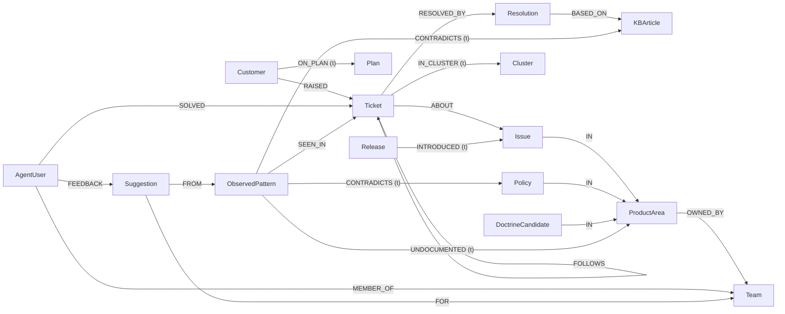

# Mochi Brain

A support desk where no ticket starts from zero.

Mochi Brain keeps one shared company memory in a FalkorDB graph. When an agent opens a ticket, Mochi briefs them: who the customer is, what fixed similar tickets, the likely cause, and who knows the issue. Every answer shows the graph path and the Cypher that produced it. Each night the brain "dreams": it reads the day's tickets, retires facts that stopped being true, finds places where the docs and the real work disagree, and writes a morning report.

All data is synthetic. The broker, **E Corp Securities**, is fictional. No real customer or company data is used anywhere in this repo.

Built for **Graph Hacks: Context for AI Agents** (WeMakeDevs × FalkorDB, Oct 15–18 2026).

## Tracks entered

1. **Agents That Act on Connected Data.** The briefing, likely cause, who-knows and blast-radius tools are multi-hop Cypher queries. Each result carries the path walked and the query text.
2. **Agent Memory and Coordination.** Memory tiers as separate graphs (company, team, user, customer), enforced by database ACL users. The dream consolidates memory with temporal invalidation. Pi Durable checkpoints let a crashed run resume.
3. **Company Brain.** Company knowledge in one graph: who owns which product area, who has solved what, what the docs promise against what tickets show. Mismatches become suggestions with ticket evidence, routed to the owning team.

## Setup from a clean clone

Needs Node 24+ and Docker.

```sh
cp .env.example .env          # set the four passwords and ANTHROPIC_API_KEY
docker compose up -d          # FalkorDB 4.22.1 with the ACL users
npm install
npm run gen                   # seeded synthetic dataset -> data/dataset.json, data/eval.json
npm run load                  # writes the graph as mochi_dream
npm run dev                   # agent: harness + chat endpoint + story API
```

| what | where |
|---|---|
| FalkorDB (Redis protocol) | `localhost:6379` |
| FalkorDB Browser (inspect the graph) | http://localhost:3000 (log in as `default` with `FALKORDB_PASSWORD`) |
| Agent server (`PORT`, default 4000) | http://localhost:4000 |
| CopilotKit / AG-UI chat endpoint | http://localhost:4000/api/copilotkit |
| Story API | `GET http://localhost:4000/api/stories/<id>?asOf=<epoch ms>` |
| Live story updates (WebSocket) | `ws://localhost:4000/api/stories/<id>/live` |
| Run the dream now | `POST http://localhost:4000/api/dream/run[?asOf=<epoch ms>]` |
| Desk UI | `npm run dev -w ui`, then http://localhost:5173 |
| Landing page | `npm run landing` (Vite picks the next free port if 5173 is taken) |

Other scripts: `npm run dream` (one dream now; stop `npm run dev` first, since one process owns the SQLite), `npm run bench`, `npm run check` (typecheck and tests in every workspace), `npm run crash-demo -w agent`.

## Graph data model

Source of truth: [`contracts/graph.ts`](contracts/graph.ts). The loader, the dream, the agent queries and the bench all import names from it.

### Graphs (memory tiers)

One FalkorDB instance holds several graphs:

| graph | what it holds | who writes |
|---|---|---|
| `mochi_company` | the company brain | only `mochi_dream` (the dream and the loader); append-only, facts retired by `valid_until` |
| `mochi_company_prev` | `GRAPH.COPY` of the brain taken before each dream | `mochi_dream` |
| `algo_scratch` | live-edge projection for graph algorithms (they ignore edge properties) | `mochi_dream` |
| `team_<slug>` | shared memory for one team (teachings, doctrine candidates) | that team's members |
| `user_<id>` | personal memory | that user only |
| `cust_<id>` | per-customer episodic memory | user conversations |

Facts beat preferences: the company graph wins on facts, user graphs win on preferences. Every node carries `source` (`seed`, `dream`, `teach`, `session`) and `created_at`, plus provenance such as `source_ticket` or `source_session`.

### ACL users (enforced by the database)

Defined in `docker-compose.yml`, checked against `contracts/graph.ts` by a test. Grants are per command; `%R~` is never used because it blocks `GRAPH.RO_QUERY`.

| user | can do |
|---|---|
| `mochi_reader` | `GRAPH.RO_QUERY`, `GRAPH.EXPLAIN`, `GRAPH.LIST` on `mochi_company` and `team_*`. Used by user conversations and the MCP server. |
| `mochi_dream` | `GRAPH.QUERY`, `GRAPH.RO_QUERY`, `GRAPH.COPY`, `GRAPH.DELETE`, `GRAPH.CONSTRAINT` on `mochi_company`, `mochi_company_prev`, `algo_scratch`, `team_*`. The only writer of the brain. |
| `user_demo` | read `mochi_company`; read and write `user_demo`, `cust_*`, `team_*`. |

A prompt-injected write from a user conversation fails at FalkorDB with `NOPERM`.

### Labels

`Customer`, `Ticket`, `Issue`, `ProductArea`, `Team`, `AgentUser`, `Resolution`, `KBArticle`, `Release`, `Plan`, `Policy`, `ObservedPattern`, `Suggestion`, `DoctrineCandidate`, `Cluster`.

Doctrine (what the company claims) lives on `KBArticle` and `Policy` (`promised_tat_hours`, `steps`). Practice (what happens) lives on `ObservedPattern` (`measured_tat_hours`, `support_count`, `last_seen`), which the dream distills from tickets.

### Edges

| edge | from | to | temporal |
|---|---|---|---|
| `RAISED` | Customer | Ticket | |
| `ON_PLAN` | Customer | Plan | yes |
| `ABOUT` | Ticket | Issue | |
| `IN` | Issue, DoctrineCandidate, Policy | ProductArea | |
| `OWNED_BY` | ProductArea | Team | |
| `SOLVED` | AgentUser | Ticket | |
| `MEMBER_OF` | AgentUser | Team | |
| `RESOLVED_BY` | Ticket | Resolution | |
| `BASED_ON` | Resolution | KBArticle | |
| `INTRODUCED` | Release | Issue | yes |
| `FOLLOWS` | Ticket | Ticket | |
| `CONTRADICTS` | ObservedPattern | KBArticle, Policy | yes |
| `UNDOCUMENTED` | ObservedPattern | ProductArea | yes |
| `SEEN_IN` | ObservedPattern | Ticket | |
| `FROM` | Suggestion | ObservedPattern | |
| `FOR` | Suggestion | Team | |
| `FEEDBACK` | AgentUser | Suggestion | |
| `IN_CLUSTER` | Ticket | Cluster | yes |

### The temporal rule

Every mutable fact is an edge with `valid_from` and `valid_until` (epoch ms). FalkorDB cannot store null, so a live fact has `valid_until = VALID_FOREVER = 253402300799000` (9999-12-31). A contradiction never edits or deletes: it runs `SET old.valid_until = $as_of` and `CREATE`s a new edge.

One filter serves live and past reads. Live reads pass `$as_of = now`:

```text
EDGE_AS_OF(r) = r.valid_from <= $as_of AND r.valid_until > $as_of
NODE_AS_OF(n) = n.created_at <= $as_of
```

Every temporal edge type has a range index on `valid_until` (`CREATE INDEX FOR ()-[r:<TYPE>]-() ON (r.valid_until)`).

### Diagram



`(t)` marks temporal edges.

## Architecture

```text
 simulated helpdesk (sim/) --webhook--> gen/listen.ts --> mochi_company (pending tickets)
                                                              |
 browser (desk UI, CopilotKit chat) --AG-UI--> agent process  |  FalkorDB
                                              |  Pi Durable harness (SQLite)
                                              |  mochi-graph tools ---- RO_QUERY as mochi_reader
                                              |  dream task ----------- writes as mochi_dream
                                              |  story API + WebSocket
```

- **FalkorDB** holds all memory and context. Hand-written Cypher, no ORM, no Graphiti. Vector search uses FalkorDB's vector index on `Ticket.embedding` (384-dim MiniLM, computed locally). Clusters use `algo.labelPropagation`. Remove FalkorDB and nothing works.
- **Pi Durable** (`@earendil-works/pi-durable`) is the agent harness. SQLite holds checkpoints and transcripts only, never memory. The root conversation is the support channel. The `mochi-graph` extension gives read tools (`briefing`, `likely_cause`, `who_knows`, `emerging_clusters`, `blast_radius`, `search_similar`, `build_story`, `render_html`), all replay-safe, and write tools (`record_resolution`, `teach`, `feedback`) with no replay: after a crash the model is told the call was interrupted, and it is never silently repeated. User conversations do not get `record_resolution`.
- **CopilotKit chat.** The web chat uses CopilotKit's headless React packages and speaks AG-UI to our endpoint, hosted inside the agent process next to the harness. Answers render as tool cards built by our code (numbers come from query rows, never from model tokens), then story tags, then sandboxed HTML as a last resort. The sandbox allows only `mochi.css` tokens, no network, and no literal digits: every figure is a placeholder filled from a stored query.
- **The dream** is a Pi Durable background task on a timer (`MOCHI_DREAM_EVERY_MS`, default 24 h), or `npm run dream`, or `POST /api/dream/run`. Steps: snapshot (`GRAPH.COPY` to `mochi_company_prev`) → ingest (LLM extraction into `MERGE` Cypher, marked by `ingested_at`) → invalidate (contradiction events retire old edges) → clusters → practice (ObservedPatterns) → mismatch rules → suggestions → doctrine review → morning report. The mismatch rules are plain arithmetic and Cypher, no LLM: a pattern whose measured time exceeds a promise by more than 25% with at least 5 supporting tickets becomes `CONTRADICTS`; a workaround used often but in no KB becomes `UNDOCUMENTED`. The LLM writes only the suggestion prose. Teachings from chat land as `DoctrineCandidate` nodes; the dream reviews and commits them as `Policy` with `taught_by` and `source_session`.
- **The simulated helpdesk** (`sim/`, landing soon, change `add-sim`). A fictional, Freshdesk-shaped ticketing system with about 3,000 E Corp Securities tickets and their mail threads: follow-ups, duplicates, merges, CC'd parties, auto-replies, bounces, spam, forwards, Hinglish. It serves a `/api/v2/` REST API with Basic auth and pagination, POSTs webhooks on a replay clock (`/sim/clock`), and keeps its ground truth in a file it never serves. `gen/listen.ts` takes each webhook, fetches the ticket and writes it to the graph as pending; the dream does the extraction. The graph, the eval and the benchmark all come from that one source. Facts never pass through the LLM: Haiku only rewords tone, and the paraphrase cache is committed so reruns cost nothing.

## Receipts and `?asOf=`

Every number in a card, story or report carries its stored query: Cypher text, graph, params, columns and rows. Click a number to see the Cypher. Every story has a link `/r/<storyId>` (versions `/r/<storyId>@<n>`); refresh re-runs the stored queries read-only, and open tabs update over WebSocket.

`?asOf=<epoch ms>` re-runs the same stored queries with that time as `$as_of`. You see what the brain believed then. Compare a report before and after a dream to watch facts retire.

## Ask the graph yourself (MCP server for judges)

`.mcp.json` registers the official FalkorDB MCP server (`@falkordb/mcpserver@1.3.0`), read-only, connected as `mochi_reader`. Open the repo in Claude Code (or any MCP client) with your `.env` loaded and ask questions about `mochi_company` directly. Writes are refused twice: by the server's strict read-only mode and by the ACL user.

## Crash demo

```sh
npm run crash-demo -w agent
```

It submits a ticket with a fixed `requestId`, sends `kill -9` while the first tool call is running, reopens the same SQLite, calls `harness.resume()` and resubmits the same `requestId`. The original submission comes back and finishes with one answer. This is demonstrated, not benchmarked.

## Benchmark

```sh
npm run bench                               # everything, from the seed
npm run bench -- --only main                # one section: main, staleness, ablation, clusters, concurrency, isolation, server
npm run bench -- --dry                      # no API spend; writes artifacts/results.dry.json
npm run bench -- --max-usd 25               # stop at a spend cap
```

Arms: A stuff-everything, B vector top-k (FalkorDB vector index, edges ignored), C file memory (the open Agent Memory Repo spec, not Devin the product), D graph (the queries below), E SQLite relational, F TencentDB Agent Memory (time-boxed). Tokens come from the provider's usage field. Single-fact answers are scored by exact match; multi-hop and structural by an LLM judge (prompt in `bench/judge.md`). Output: `bench/results.json`, the only source of published figures. We report the buckets where other arms win.

### Feature Ledger

Every graph feature has a row, good or bad. A row that says "not measured" says so in public.

<!-- ledger:start (generated by scripts/readme-cypher.ts, do not edit) -->
_Feature Ledger: pending benchmark run. `bench/results.json` does not exist yet, so no figures are shown._
<!-- ledger:end -->

## The Cypher the product depends on

Generated from the code by `scripts/readme-cypher.ts`. `node scripts/readme-cypher.ts --check` fails if this section drifts from the code. `${EDGE_AS_OF}` and `${NODE_AS_OF}` are already expanded below.

<!-- cypher:start (generated by scripts/readme-cypher.ts, do not edit) -->
### Agent queries (the five load-bearing queries + similarity)

Source: `agent/queries/index.ts`.

#### `briefing.profile`

```cypher
/* mochi:briefing.profile@v1 */
MATCH (c:Customer)-[:RAISED]->(t:Ticket {id: $ticketId})
WHERE c.created_at <= $as_of AND t.created_at <= $as_of
OPTIONAL MATCH (c)-[op:ON_PLAN]->(p:Plan) WHERE op.valid_from <= $as_of AND op.valid_until > $as_of
OPTIONAL MATCH (t)-[:ABOUT]->(i:Issue) WHERE i.created_at <= $as_of
RETURN c.id AS customer_id, c.name AS name, c.segment AS segment, c.city AS city, p.name AS plan,
       t.subject AS ticket_subject, i.id AS issue_id
```

#### `briefing.recent`

```cypher
/* mochi:briefing.recent@v1 */
MATCH (c:Customer)-[:RAISED]->(:Ticket {id: $ticketId}), (c)-[r:RAISED]->(t:Ticket)
WHERE t.id <> $ticketId AND t.created_at <= $as_of
RETURN t.id AS ticket, t.subject AS subject, t.status AS status, t.created_at AS created_at
ORDER BY t.created_at DESC, t.id LIMIT 3
```

#### `briefing.similar`

```cypher
/* mochi:briefing.similar@v1 path: graph */
MATCH (t:Ticket {id: $ticketId})-[:ABOUT]->(i:Issue)<-[:ABOUT]-(s:Ticket)-[:RESOLVED_BY]->(r:Resolution)
WHERE s.id <> t.id AND t.created_at <= $as_of AND i.created_at <= $as_of AND s.created_at <= $as_of AND r.created_at <= $as_of AND s.resolved_at <= $as_of
OPTIONAL MATCH (r)-[:BASED_ON]->(k:KBArticle) WHERE k.created_at <= $as_of
RETURN s.id AS ticket, s.subject AS subject, i.id AS issue_id, i.name AS issue,
       r.id AS resolution_id, r.summary AS resolution, k.id AS kb_id, k.title AS kb
ORDER BY s.resolved_at DESC, s.id LIMIT 5
```

#### `briefing.similarVector`

```cypher
/* mochi:briefing.similar@v1 path: vector→graph */
MATCH (t:Ticket {id: $ticketId})
CALL db.idx.vector.queryNodes('Ticket', 'embedding', $k, t.embedding) YIELD node, score
WITH t, node AS s, score
WHERE s.id <> t.id AND s.created_at <= $as_of AND s.resolved_at <= $as_of
MATCH (s)-[:RESOLVED_BY]->(r:Resolution) WHERE r.created_at <= $as_of
OPTIONAL MATCH (s)-[:ABOUT]->(i:Issue)
OPTIONAL MATCH (r)-[:BASED_ON]->(k:KBArticle) WHERE k.created_at <= $as_of
RETURN s.id AS ticket, s.subject AS subject, i.id AS issue_id, i.name AS issue,
       r.id AS resolution_id, r.summary AS resolution, k.id AS kb_id, k.title AS kb, score
ORDER BY score, s.id LIMIT 5
```

#### `likelyCause`

```cypher
/* mochi:likely_cause@v1 */
MATCH (t:Ticket {id: $ticketId})-[:ABOUT]->(i:Issue)<-[x:INTRODUCED]-(r:Release)
WHERE x.valid_from <= $as_of AND x.valid_until > $as_of AND t.created_at <= $as_of AND i.created_at <= $as_of AND r.created_at <= $as_of
RETURN t.id AS ticket, t.subject AS subject, i.id AS issue_id, i.name AS issue,
       r.version AS release, r.shipped_at AS shipped_at, x.valid_from AS introduced_at
ORDER BY r.shipped_at DESC, r.version LIMIT 3
```

#### `whoKnows`

```cypher
/* mochi:who_knows@v1 */
MATCH (a:AgentUser)-[s:SOLVED]->(t:Ticket)-[:ABOUT]->(i:Issue {id: $issueId})
WHERE a.created_at <= $as_of AND t.created_at <= $as_of AND i.created_at <= $as_of
WITH a, i, count(s) AS solved, min(t.id) AS example_ticket
OPTIONAL MATCH (a)-[:MEMBER_OF]->(tm:Team)
RETURN a.id AS agent_id, a.name AS agent, tm.name AS team, solved, example_ticket, i.name AS issue
ORDER BY solved DESC, agent_id LIMIT 5
```

#### `emergingClusters`

```cypher
/* mochi:emerging_clusters@v1 */
MATCH (t:Ticket)-[m:IN_CLUSTER]->(c:Cluster)
WHERE m.valid_from <= $as_of AND m.valid_until > $as_of AND c.created_at <= $as_of AND t.created_at <= $as_of
WITH c, count(m) AS tickets, sum(CASE WHEN t.created_at > $as_of - $window_ms THEN 1 ELSE 0 END) AS growth
RETURN c.id AS cluster, tickets, growth
ORDER BY growth DESC, tickets DESC, cluster LIMIT 10
```

#### `blastRadius.segments`

```cypher
/* mochi:blast_radius.segments@v1 */
MATCH (r:Release {version: $version})-[x:INTRODUCED]->(i:Issue)<-[a:ABOUT]-(t:Ticket)<-[rz:RAISED]-(c:Customer)
WHERE x.valid_from <= $as_of AND x.valid_until > $as_of AND r.created_at <= $as_of AND i.created_at <= $as_of AND t.created_at <= $as_of AND c.created_at <= $as_of
RETURN c.segment AS segment, count(DISTINCT c) AS customers, count(DISTINCT t) AS tickets
ORDER BY customers DESC, segment
```

#### `blastRadius.totals`

```cypher
/* mochi:blast_radius.totals@v1 */
MATCH (r:Release {version: $version})-[x:INTRODUCED]->(i:Issue)<-[a:ABOUT]-(t:Ticket)<-[rz:RAISED]-(c:Customer)
WHERE x.valid_from <= $as_of AND x.valid_until > $as_of AND r.created_at <= $as_of AND i.created_at <= $as_of AND t.created_at <= $as_of AND c.created_at <= $as_of
RETURN count(DISTINCT c) AS customers, count(DISTINCT t) AS tickets,
       count(DISTINCT CASE WHEN t.resolved_at IS NULL OR t.resolved_at > $as_of THEN t END) AS open_tickets
```

#### `blastRadius.affected`

```cypher
/* mochi:blast_radius.affected@v1 */
MATCH (r:Release {version: $version})-[x:INTRODUCED]->(i:Issue)<-[a:ABOUT]-(t:Ticket)<-[rz:RAISED]-(c:Customer)
WHERE x.valid_from <= $as_of AND x.valid_until > $as_of AND r.created_at <= $as_of AND i.created_at <= $as_of AND t.created_at <= $as_of AND c.created_at <= $as_of
RETURN c.id AS customer_id, c.name AS customer, c.segment AS segment, t.id AS ticket, t.subject AS subject,
       i.id AS issue_id, i.name AS issue,
       CASE WHEN t.resolved_at IS NULL OR t.resolved_at > $as_of THEN 'open' ELSE 'resolved' END AS state
ORDER BY t.created_at DESC, t.id LIMIT 10
```

#### `searchSimilar`

```cypher
/* mochi:search_similar@v1 */
CALL db.idx.vector.queryNodes('Ticket', 'embedding', $fetch, vecf32($vector)) YIELD node, score
WITH node AS t, score WHERE t.created_at <= $as_of
OPTIONAL MATCH (t)-[:ABOUT]->(i:Issue)
RETURN t.id AS ticket, t.subject AS subject, t.status AS status, i.name AS issue, score
ORDER BY score, ticket LIMIT $k
```

### Dream queries (the only writer of mochi_company)

Source: `agent/dream/cypher.ts`.

#### `pendingTickets`

```cypher
MATCH (t:Ticket) WHERE t.ingested_at IS NULL AND t.created_at <= $as_of
OPTIONAL MATCH (t)-[:ABOUT]->(i:Issue)
OPTIONAL MATCH (t)-[:RESOLVED_BY]->(res:Resolution)
RETURN t.id AS id, t.subject AS subject, t.body AS body, t.status AS status, i.id AS issue_id, res.id AS res_id
ORDER BY t.id
```

#### `areas`

```cypher
MATCH (a:ProductArea) RETURN a.name AS name
```

#### `issues`

```cypher
MATCH (i:Issue)-[:IN]->(a:ProductArea) RETURN i.id AS id, i.name AS name, a.name AS area, i.created_at AS created_at ORDER BY i.created_at DESC, i.id
```

#### `ingestBatch`

```cypher
UNWIND $rows AS r
MATCH (t:Ticket {id: r.ticket_id}) WHERE t.ingested_at IS NULL
MATCH (a:ProductArea {name: r.area})
MERGE (i:Issue {id: r.issue_id})
ON CREATE SET i.name = r.issue_name, i.first_seen = t.created_at, i.created_at = $as_of, i.source = 'dream', i.source_ticket = r.ticket_id
MERGE (i)-[:IN]->(a)
MERGE (t)-[:ABOUT]->(i)
SET t.ingested_at = $as_of, t.batch_id = $batch_id, t.batch_size = $batch_size
WITH t, r
FOREACH (_ IN CASE WHEN r.res_kind <> '' THEN [1] ELSE [] END |
  MERGE (res:Resolution {id: r.res_id})
  ON CREATE SET res.kind = r.res_kind, res.summary = r.res_summary, res.created_at = $as_of, res.source = 'dream', res.source_ticket = r.ticket_id
  MERGE (t)-[:RESOLVED_BY]->(res))
RETURN count(t) AS written
```

#### `windowPairs`

```cypher
MATCH (t:Ticket)-[:ABOUT]->(i:Issue)
WHERE t.created_at > $as_of - 604800000 AND t.created_at <= $as_of AND i.created_at <= $as_of
RETURN t.id AS t, i.id AS i, i.name AS name ORDER BY t.id, i.id
```

#### `projectPairs`

```cypher
UNWIND $rows AS r MERGE (t:Ticket {id: r.t}) MERGE (i:Issue {id: r.i}) MERGE (t)-[:ABOUT]->(i)
```

#### `labelPropagation`

```cypher
CALL algo.labelPropagation({nodeLabels: ['Ticket', 'Issue'], relationshipTypes: ['ABOUT'], maxIterations: 10}) YIELD node, communityId
WITH node, communityId WHERE node:Ticket
RETURN communityId, node.id AS id ORDER BY id
```

#### `retireClusterEdges`

```cypher
UNWIND $rows AS r
MATCH (t:Ticket {id: r.t})-[old:IN_CLUSTER]->(oc:Cluster)
WHERE old.valid_from <= $as_of AND old.valid_until > $as_of AND oc.id <> r.c
SET old.valid_until = $as_of
RETURN count(old) AS retired
```

#### `createClusterEdges`

```cypher
UNWIND $rows AS r
MATCH (t:Ticket {id: r.t})
MERGE (c:Cluster {id: r.c})
ON CREATE SET c.name = r.name, c.created_at = $as_of, c.source = 'dream', c.source_ticket_ids = r.members
WITH t, c
OPTIONAL MATCH (t)-[cur:IN_CLUSTER]->(c) WHERE cur.valid_from <= $as_of AND cur.valid_until > $as_of
WITH t, c, count(cur) AS live WHERE live = 0
CREATE (t)-[e:IN_CLUSTER {valid_from: $as_of, valid_until: 253402300799000, source: 'dream', created_at: $as_of}]->(c)
RETURN count(e) AS created
```

#### `kbResolved`

```cypher
MATCH (t:Ticket)-[:RESOLVED_BY]->(:Resolution)-[:BASED_ON]->(kb:KBArticle), (t)-[:ABOUT]->(i:Issue)-[:IN]->(a:ProductArea)
WHERE t.resolved_at IS NOT NULL AND t.resolved_at <= $as_of AND t.created_at <= $as_of
RETURN kb.id AS target, i.id AS issue, a.name AS area, kb.promised_tat_hours AS promised, t.id AS tid, t.created_at AS created, t.resolved_at AS resolved
ORDER BY tid
```

#### `policyResolved`

```cypher
MATCH (p:Policy)-[:IN]->(a:ProductArea)<-[:IN]-(:Issue)<-[:ABOUT]-(t:Ticket)
WHERE p.promised_tat_hours IS NOT NULL AND p.created_at <= $as_of AND t.resolved_at IS NOT NULL AND t.resolved_at <= $as_of
RETURN p.id AS target, a.name AS area, p.promised_tat_hours AS promised, t.id AS tid, t.created_at AS created, t.resolved_at AS resolved
ORDER BY tid
```

#### `workarounds`

```cypher
MATCH (t:Ticket)-[:RESOLVED_BY]->(res:Resolution), (t)-[:ABOUT]->(:Issue)-[:IN]->(a:ProductArea)
WHERE res.kind = 'workaround' AND NOT (res)-[:BASED_ON]->(:KBArticle) AND t.created_at <= $as_of
RETURN a.name AS area, res.summary AS summary, t.id AS tid, t.created_at AS created
ORDER BY tid
```

#### `writePatterns`

```cypher
UNWIND $rows AS r
MERGE (p:ObservedPattern {id: r.id})
ON CREATE SET p.key = r.key, p.kind = r.kind, p.run_id = $run, p.area = r.area, p.summary = r.summary,
  p.measured_tat_hours = r.measured, p.support_count = r.support, p.last_seen = r.last_seen,
  p.source = 'dream', p.created_at = $as_of, p.source_ticket_ids = r.tickets
WITH p, r
UNWIND r.tickets AS tid
MATCH (t:Ticket {id: tid})
MERGE (p)-[:SEEN_IN]->(t)
```

#### `retireMismatches`

```cypher
MATCH (o:ObservedPattern)-[e:CONTRADICTS|UNDOCUMENTED]->()
WHERE o.run_id <> $run AND e.valid_from <= $as_of AND e.valid_until > $as_of
SET e.valid_until = $as_of
RETURN count(e) AS retired
```

#### `contradictsKB`

```cypher
UNWIND $rows AS r
MATCH (p:ObservedPattern {id: r.pid}), (d:KBArticle {id: r.target})
MERGE (p)-[c:CONTRADICTS]->(d)
ON CREATE SET c.delta = r.delta, c.promised = r.promised, c.measured = r.measured, c.valid_from = $as_of, c.valid_until = 253402300799000, c.source = 'dream', c.created_at = $as_of
RETURN count(c) AS n
```

#### `contradictsPolicy`

```cypher
UNWIND $rows AS r
MATCH (p:ObservedPattern {id: r.pid}), (d:Policy {id: r.target})
MERGE (p)-[c:CONTRADICTS]->(d)
ON CREATE SET c.delta = r.delta, c.promised = r.promised, c.measured = r.measured, c.valid_from = $as_of, c.valid_until = 253402300799000, c.source = 'dream', c.created_at = $as_of
RETURN count(c) AS n
```

#### `undocumented`

```cypher
UNWIND $rows AS r
MATCH (p:ObservedPattern {id: r.pid}), (a:ProductArea {name: r.area})
MERGE (p)-[u:UNDOCUMENTED]->(a)
ON CREATE SET u.support_count = r.support, u.valid_from = $as_of, u.valid_until = 253402300799000, u.source = 'dream', u.created_at = $as_of
RETURN count(u) AS n
```

#### `feedback`

```cypher
MATCH (:AgentUser)-[f:FEEDBACK]->(s:Suggestion) RETURN s.id AS id, f.verdict AS verdict, f.at AS at
```

#### `suggestions`

```cypher
MATCH (s:Suggestion) WHERE s.created_at <= $as_of RETURN s.id AS id, s.key AS key, s.status AS status, s.expires_at AS expires_at, s.created_at AS created_at ORDER BY s.created_at, s.id
```

#### `setSuggestionStatus`

```cypher
UNWIND $rows AS r MATCH (s:Suggestion {id: r.id}) WHERE s.status <> r.status SET s.status = r.status
```

#### `owner`

```cypher
MATCH (:ProductArea {name: $area})-[:OWNED_BY]->(team:Team) RETURN team.name AS team
```

#### `createSuggestions`

```cypher
UNWIND $rows AS r
MATCH (p:ObservedPattern {id: r.pid})
MATCH (:ProductArea {name: r.area})-[:OWNED_BY]->(team:Team)
MERGE (s:Suggestion {id: r.id})
ON CREATE SET s.key = r.key, s.edge = r.edge, s.text = r.text, s.area = r.area, s.evidence_ticket_ids = r.tickets,
  s.source_ticket_ids = r.tickets, s.support_count = r.support, s.confidence = r.confidence, s.expires_at = r.expires_at,
  s.status = 'open', s.source = 'dream', s.created_at = $as_of
MERGE (s)-[:FROM]->(p)
MERGE (s)-[:FOR]->(team)
RETURN count(DISTINCT s) AS n
```

#### `candidates`

```cypher
MATCH (d:DoctrineCandidate)-[:IN]->(a:ProductArea)
WHERE d.reviewed_at IS NULL AND d.text IS NOT NULL
RETURN id(d) AS nid, d.text AS text, a.name AS area, d.promised_tat_hours AS promised, d.steps AS steps,
  d.taught_by AS taught_by, d.source_session AS source_session, d.created_at AS created_at
ORDER BY d.created_at, nid
```

#### `commitPolicies`

```cypher
UNWIND $rows AS r
MATCH (a:ProductArea {name: r.area})
MERGE (p:Policy {id: r.id})
ON CREATE SET p.text = r.text, p.promised_tat_hours = r.promised, p.steps = r.steps, p.source = 'teach',
  p.taught_by = r.taught_by, p.source_session = r.source_session, p.created_at = $as_of
MERGE (p)-[:IN]->(a)
RETURN count(p) AS n
```

#### `markReviewed`

```cypher
MATCH (d:DoctrineCandidate) WHERE id(d) IN $ids SET d.reviewed_at = $as_of
```

#### `counts`

```cypher
MATCH (n) WITH count(n) AS nodes OPTIONAL MATCH ()-[e]->() RETURN nodes, count(e) AS edges
```

### Morning report stored queries

Source: `agent/dream/cypher.ts`.

#### `memdiff`

```cypher
MATCH (a)-[e:ON_PLAN|INTRODUCED]->(b)
WHERE e.valid_until > $as_of - 86400000 AND e.valid_until <= $as_of
RETURN 'retired' AS change, coalesce(a.id, a.version, a.name) + ' ' + type(e) + ' ' + coalesce(b.id, b.version, b.name) AS fact
UNION ALL
MATCH (a)-[e:ON_PLAN|INTRODUCED]->(b)
WHERE e.valid_from > $as_of - 86400000 AND e.valid_from <= $as_of AND e.valid_until > $as_of
RETURN 'added' AS change, coalesce(a.id, a.version, a.name) + ' ' + type(e) + ' ' + coalesce(b.id, b.version, b.name) AS fact
```

#### `clusters`

```cypher
MATCH (:Ticket)-[e:IN_CLUSTER]->(c:Cluster)
WHERE e.valid_from <= $as_of AND e.valid_until > $as_of AND c.created_at <= $as_of
WITH c, count(e) AS tickets, sum(CASE WHEN e.valid_from <= $as_of - 86400000 THEN 1 ELSE 0 END) AS before
RETURN c.name + ' (' + c.id + ')' AS cluster, tickets, tickets - before AS trend
ORDER BY trend DESC, tickets DESC, cluster LIMIT 8
```

#### `ingested`

```cypher
MATCH (t:Ticket) WHERE t.batch_id IS NOT NULL AND t.ingested_at > $as_of - 86400000 AND t.ingested_at <= $as_of
RETURN count(t) AS ingested
```

#### `suggestion`

```cypher
MATCH (s:Suggestion {id: $id})-[:FROM]->(p:ObservedPattern)-[e:CONTRADICTS|UNDOCUMENTED]->(d)
WHERE s.created_at <= $as_of AND e.valid_from <= $as_of
MATCH (s)-[:FOR]->(team:Team)
RETURN s.id AS id, type(e) AS edge, coalesce(d.id, d.name) AS target, team.name AS team, s.support_count AS support,
  s.confidence AS confidence, p.measured_tat_hours AS measured, e.promised AS promised, e.delta AS delta, s.status AS status
```
<!-- cypher:end -->

## AI-assistant disclosure

Built with **Claude Code** running **Claude Opus 5.5**. We used it to write proposals and specs (OpenSpec), write and test code in parallel git worktrees, and review diffs. A human approved every spec amendment and design decision; those approvals are dated in `docs/SPEC.md`. The team can explain every graph model, query and architectural decision in this repo.

At runtime the product uses Anthropic models through `pi-ai`: `claude-haiku-5-5` by default for chat, extraction and suggestion prose, and `claude-opus-5-5` as the benchmark judge.

## Credits

- [FalkorDB](https://www.falkordb.com/): the graph database, Browser and MCP server.
- Pi Durable (`@earendil-works/pi-durable`, `pi-ai`, `chord`): the agent harness.
- [CopilotKit](https://www.copilotkit.ai/): headless React chat and the AG-UI runtime.
- [Aceternity UI](https://ui.aceternity.com/): patterns for the landing-page effects, adapted to our tokens, not copied.
- nao: inspiration for context as an engineered artifact, data stories with receipts, and right/wrong feedback on suggestions.

## Licence

MIT.
